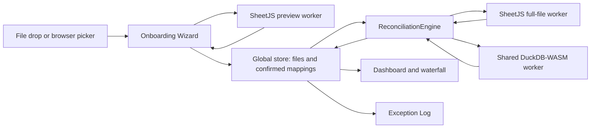

# Reconciliation Auto-Pilot — AI Context Restorer

Architecture and implementation snapshot: **2026-11-12**. This README is a project handoff that can be pasted into a new AI conversation. It describes the existing application, accepted accounting rules, completed work, and next development direction. Source files and executable tests are the final authority when this snapshot becomes outdated.

## 1. Project overview and completion status

Reconciliation Auto-Pilot is a browser-only finance workspace that explains the difference between operational sales and financial ledger revenue. Users import POS, WEB, Finance GL, Sales Flash, and optional Master/Dim files, map their columns, and run a traceable reconciliation. Results appear in a revenue waterfall, daily store comparisons, and a searchable Exception Log.

**Phases 1–4 are completed:** application scaffolding and ingestion, DuckDB reconciliation, Dashboard/Exception Log, and shared state with coordinated processing. The subsequent mapping and onboarding refinements are also implemented:

- Phase 1.5: per-file mapping, smart suggestions, and spreadsheet previews.
- Phase 1.6: five-step onboarding modal connected to real processing.
- Phase 1.8: optional POS/WEB net amount with a gross-minus-discount fallback.
- Phase 1.9: dynamic header-row selection for metadata-heavy files.
- Phase 1.10: one stable header selector per file and correct rapid +/- updates.

The project is already scaffolded and functional. There is no backend upload service, account system, or durable financial-data storage. Files, mappings, and results live in this browser tab and are lost on refresh. Production screens use uploaded data; synthetic fixtures belong to tests.

The interface has a shared finance design system: a forest-green sidebar, compact reporting controls, exact-cent KPIs, a focused bridge, daily comparisons and an exception preview. Data sources is now a five-source management page rather than an automatic modal entry. Each source opens its own step in the shared wizard. Desktop import uses a 208px source rail with a separately scrolling body and a stable footer; mobile uses compact source navigation. Visiting a source directly never waives completion validation. Source badges distinguish pending previews from actively reading the current wizard source. No demo data or accounting SQL was added for this visual refresh.

The import wizard uses one viewport-sized shell for empty, reading, mapping, warning/error, Master / Dim and validation states. Its desktop width is `min(1440px, 100vw - 48px)` and height is `min(90dvh, 960px)`, controlled only in `src/ingestion-wizard.css`. Header/footer tracks and Back/primary action slots remain stable; Master actions occupy a reserved secondary slot. Mobile and short viewports use a nearly full-screen shell, with compact source navigation on mobile. The main panel reserves a scrollbar gutter and keeps the step heading visible while scrolling; short screens let that heading scroll with the content to keep fields accessible. Only opening the wizard or changing the active source/file resets its scroll/focus. Preview, mapping and header-row updates keep their mounted controls and scroll position. No upload, validation, processing or step-readiness rules changed.

## 2. Technology stack and local commands

| Technology               | Responsibility                                                             |
| ------------------------ | -------------------------------------------------------------------------- |
| React + TypeScript       | Typed components, hooks, Context, and observable application state         |
| Vite                     | Development server, bundling, workers, WASM assets, and `@/*` aliases      |
| Tailwind CSS v4          | Styling through the Vite plugin and theme variables in `src/index.css`     |
| shadcn/ui + Radix UI     | Local Dialog, Select, Table, Button, Input, Badge, and other UI components |
| DuckDB-WASM              | In-browser SQL, normalization, accounting validation, and aggregation      |
| SheetJS (`xlsx`)         | CSV/XLSX parsing, worksheet selection, previews, and CSV conversion        |
| Recharts                 | Revenue reconciliation waterfall                                           |
| React Router             | Hash-based routes suitable for static hosting                              |
| Node test runner + jsdom | Logic, real DuckDB integration, and React DOM regression tests             |

Use Node.js **22.12+**; Node 24 LTS is recommended. Dependencies and versions are recorded in `package.json` and `package-lock.json`; do not recreate the scaffold or replace the lockfile casually. SheetJS is installed from its vendor-distributed 0.20.3 tarball. jsdom is a development dependency pinned for compatibility with the supported Node baseline.

```bash
npm ci
npm run dev
npm test
npm run build
npm run format:check
```

On Windows PowerShell, use `npm.cmd` / `npx.cmd` if execution policy blocks the `.ps1` wrappers. `npm run build` runs strict TypeScript checks and a production Vite build. `npm run lint` invokes oxlint. Open the local URL printed by Vite; do not open the application using `file://`.

## 3. System architecture

The user-facing pipeline is:

**File drop → Onboarding Wizard / Mapping → DuckDB-WASM processing → Global state → Dashboard / Exception Log.**

The global store owns drafts before processing as well as the final results:



`DuckDBProvider` owns one shared database. `AppStoreProvider` connects the store to that database and explicitly selects **`ingestionMode: 'wizard'`** and **`schemaMode: 'accounting'`**. The wizard saves confirmed per-file mappings; the engine applies them to SQL projections. Successful bridge and exception results are published together.

Routes:

| Hash route            | Behavior                                                       |
| --------------------- | -------------------------------------------------------------- |
| `#/`                  | Dashboard; Import Data opens the shared wizard                 |
| `#/ingestion`         | Source management; cards open the shared wizard at that source |
| `#/ingestion/mapping` | Legacy bookmark that redirects to ingestion                    |
| `#/exceptions`        | Exception Log using the same result snapshot                   |
| `#/processing`        | Retained same-run table previews and processing inspector      |
| `#/accounting-review` | Interactive GL review, evidence, correction previews and audit |
| `#/settings`          | Engine status and clearing the current selection               |

Interactive GL accounting review is implemented. Unallocated journals remain in company GL; blocking financial-data errors retain source diagnostics. Review decisions and exception controls share browser-session state, and financial corrections use reasoned overlays with previews, recomputation and undo. See [GL_ACCOUNTING_REVIEW.md](GL_ACCOUNTING_REVIEW.md) for the diagnosis, data contracts and validation scope.

## 4. Source tree and ownership

```text
src/
├── App.tsx                         # Providers and hash routes
├── main.tsx                        # React entry point
├── index.css                       # Tailwind v4 and application theme
├── assets/                         # Static assets; no production data fixtures
├── components/
│   ├── AppStoreProvider.tsx         # Store-to-DuckDB processing connection
│   ├── CompatibilityNotice.tsx      # Accounting notes / explicit legacy notices
│   ├── SourceIcon.tsx               # Source labels, icons, and colors
│   ├── layout/
│   │   └── AppLayout.tsx            # Sidebar, shell, and shared wizard instance
│   ├── ingestion/
│   │   ├── OnboardingWizard.tsx     # Five-step modal and upload orchestration
│   │   ├── DataMappingView.tsx      # One-file mapping editor and preview
│   │   └── HeaderRowSelector.tsx    # Single header-row input and +/- controls
│   ├── dashboard/
│   │   ├── WaterfallChart.tsx       # Recharts waterfall with exact-cent inputs
│   │   ├── SourceSchema.tsx         # Human-readable schema and accounting help
│   │   ├── ExceptionLog.tsx         # Reusable exception table
│   │   └── exceptions/
│   │       ├── ExceptionBadge.tsx
│   │       └── ExceptionActions.tsx
│   └── ui/                         # Local shadcn/ui components
│       └── button, input, dialog, select, table, card, badge,
│           dropdown-menu, sheet, tabs, separator, skeleton
├── hooks/
│   └── useDuckDB.tsx                # Shared database Context and readiness
├── pages/
│   ├── Dashboard.tsx
│   ├── DataIngestion.tsx
│   ├── DataMapping.tsx              # Legacy route redirect
│   ├── ExceptionLog.tsx
│   └── Settings.tsx
├── lib/
│   ├── store.ts                    # State, actions, confirmation, stale-run guards
│   ├── uploads.ts                  # Sources, queued files, limits, validation
│   ├── onboarding.ts               # Step definitions and readiness rules
│   ├── source-status.ts            # Shared preview/mapping status for cards and navigation
│   ├── data-mapping.ts             # Mapping schema, aliases, validation, snapshots
│   ├── header-row.ts               # Scalar updates, bounds, recoverable error type
│   ├── mapping-preview.ts          # Bounded SheetJS preview parsing
│   ├── read-mapping-preview.ts     # Preview worker client and cancellation
│   ├── spreadsheet-range.ts        # Selected rows and metadata-only columns
│   ├── spreadsheet.ts              # Full CSV/XLSX conversion for ingestion
│   ├── spreadsheet-types.ts        # Spreadsheet worker messages
│   ├── decode-spreadsheet.ts       # Full-file worker client
│   ├── duckdb.ts                   # One database instance and bundled WASM assets
│   ├── ReconciliationEngine.ts     # Registration, projections, SQL, results, cleanup
│   ├── reconciliation-accounting.ts # Production accounting and dimension lookups
│   ├── reconciliation-sql.ts       # Normalized views, daily comparison, bridge SQL
│   ├── reconciliation-schema.ts    # Schema help and legacy strict-mode columns
│   ├── reconciliation-types.ts     # Result types and waterfall transformation
│   ├── reconciliation-compatibility.ts # Explicit legacy adapter; not production
│   ├── exceptions.ts               # Exception types, filtering, drafts, CSV content
│   ├── exception-download.ts       # Browser-local CSV downloads
│   ├── format-money.ts             # Exact-cent currency formatting
│   └── utils.ts                    # Shared class-name utilities
└── workers/
    ├── mapping-preview.worker.ts   # Bounded previews; recoverable header errors
    └── spreadsheet.worker.ts       # Full workbook decompression and conversion
```

Root configuration includes `vite.config.ts`, TypeScript configs, `components.json`, `package.json`, and the lockfile. `tests/` contains mapping, onboarding, header-row, DOM, store, exception, and real DuckDB integration tests. `tests/fixtures/` contains synthetic test inputs, not runtime demo data.

## 5. Onboarding, mappings, and header-row behavior

The modal steps are **POS → WEB → Finance GL → Sales Flash → Master/Dim**. The first four sources are required; Master/Dim is optional.

Each step starts with a focused upload area. A selected file immediately starts preview parsing and then shows system fields on the left, source-column selects on the right, and the first **three** data rows below. Smart matching ignores case, punctuation, spacing, and camelCase; known aliases include `line_amount`, `posting_date`, `net_amount`, and `Net Sales`. Conservative fuzzy matching leaves uncertain choices unmapped.

Next Step requires a valid preview and all required mappings in every selected file for that source. Optional unmapped fields do not block it; a mapped optional field must still point to a valid, distinct column. Back and modal dismissal preserve drafts. Final completion requires all four fact sources and full mappings & joins validation of any attached Master workbook. It closes the modal, opens Dashboard, and starts processing, or waits for engine initialization.

### Dynamic Header Row Number

- Default: **1**, using one-based source row numbers.
- **Sales Flash profile: choose Header Row 5 to skip the first four metadata rows.** This is a user-controlled setting, not an unconditional hardcoded skip.
- Row 5 is passed to SheetJS as `range: 4`. Preview reads expand through the selected header plus six sample rows, even when the header is below the initial preview window.
- Fact sources retain one header row per file. Master / Dim uses one header row per worksheet; roles sharing a sheet share that selection. Only the open worksheet renders a selector.
- Metadata or missing/duplicate headers produce a polite amber warning with the row selector available. Corrupt files retain actionable file errors.
- Changing the row cancels the previous preview, clears that file's old mappings, and reparses. Other files keep their drafts. Stale responses from an earlier row are ignored.
- Original row numbers and column letters remain visible. Columns used only by excluded metadata do not create phantom missing-header errors.
- Full-file ingestion uses exactly the same row selection. CSV records are parsed correctly even when quoted fields contain newlines.

**Do not regress header behavior:** fact `headerRow` remains a scalar per file; Master keeps scalars in `master.sheets[sheetName]`. +/- uses functional updates against the latest value, bounded to 1–1,048,576. Changing a Master header clears only mappings for roles using that sheet, cancels its pending preview, and invalidates full validation and confirmation. Other sheet previews and mappings remain intact.

### Core mapping contracts

```ts
interface QueuedFile {
  id: string
  file: File
  source: 'POS' | 'WEB' | 'GL' | 'Flash' | 'Dim' | ''
  headerRow?: number // Default 1; persisted per file
  sample?: boolean
}

interface ConfirmedFileMapping {
  fileId: string
  fileName: string
  source: 'POS' | 'WEB' | 'GL' | 'Flash'
  columns: Partial<Record<MappingFieldId, string>>
  headerRow?: number // Non-default selection included in the snapshot
}
```

`MappingFieldId` includes `transaction_id`, `date`, `gross_amount`, `discount`, `net_amount`, `store_key`, `line_no`, `order_status`, `journal_type`, `posting_date`, `delivery_date`, `return_date`, and `exported_at`. `mappingDrafts` is keyed by file ID and stores its preview, current column choices, optional dimension previews, and any typed parsing error. Two files for one source can have different headers and mappings.

Confirmed selections override automatic/native header discovery. Clearing an optional selection means it is deliberately unmapped; the processor must not rediscover a familiar column and silently use it.

## 6. Data schema and source-specific business rules

The mapping schema lives in `data-mapping.ts`; production SQL projections live in `reconciliation-accounting.ts`. UI labels are standard fields, while SQL uses normalized accounting names. Custom source headers are supported through explicit mappings.

| Source | Required wizard mappings                                               | Optional mappings                                    |
| ------ | ---------------------------------------------------------------------- | ---------------------------------------------------- |
| POS    | Transaction ID, Date, Gross Amount, Discount, Store ID, Line Number    | Net Amount, Posting Date, Exported At                |
| WEB    | Transaction ID, Date, Gross Amount, Discount, Order Status             | Net Amount, Store ID, Delivery Date, Return Date     |
| GL     | Transaction ID, Date, signed Net Amount, Store ID, Journal Type        | None of these required fields can be omitted         |
| Flash  | Date, Gross Amount / monthly revenue                                   | No transaction ID required                           |
| Dim    | Explicit role, sheet, field and relationship mappings; full validation | Optional until uploaded; enabled roles must be valid |

Optional WEB date mappings remain conditionally required by the actual order rows. Preview readiness is not full accounting validation.

The wizard requires gross and discount mappings. The programmatic accounting adapter also retains documented alternatives, such as supplied-net-only inputs and an absent USD discount column meaning no discount, with a mapping note. These existing alternatives are not permission to add arbitrary zero-value fallbacks.

### POS: receipt lines and duplicate exports

- Identity: `receipt_no` + `line_no`; store: `store_key` or a mapped store alias.
- Transaction date: `business_date`. Optional `posting_date` controls finance recognition.
- Gross commonly comes from **`line_amount`**; explicit gross USD fields are also supported.
- Discount can come from local **`discount_amount`** or explicit **`discount_usd_daily`**; their currency bases are retained separately.
- Net is **Gross − Discount when Net Amount is unmapped**. A mapped supplied net, commonly `net_usd_month_end`, is authoritative and is not discounted again.
- Production deduplication computes `export_seq` and `keep_rank` using `ROW_NUMBER()` partitioned by receipt and line. The earliest `exported_at` wins; supplied source sequence and stable file/row order break ties or provide fallback ordering.
- **Keep computed `export_seq = 1`.** Do not blindly filter the original uploaded sequence to 1; an earlier timestamp can identify a different source row as the keeper.
- A confirmed Calendar posting relationship can explicitly supply POS recognition dates. Otherwise mapped posting date takes precedence, then business date. No working-day offset is inferred.
- Local `line_amount` requires a currency when USD must be derived. Compute `net_local = line_amount - discount_amount`, then divide local amounts by confirmed `usd_to_ccy` rates. Daily gross/discount/net and recognition net retain separate bases; recognition uses the configured month-end rate when present, otherwise the configured daily rate. Missing, duplicate or invalid rates block processing with cause codes. Currency is never assumed to be USD. A currency attribute alone does not reclassify explicitly mapped USD columns as local money.
- Pipeline: **Raw → Staging → computed export ranking → keeper Cleaning → reference mapping → USD → validated Fact**. `fact_POS_final` reads only keeper USD rows. Discarded exports feed `q_POS_Dup_Rows` and `q_POS_Dup_Impact`, never the fact. `pos_clean` is the all-export converted audit relation used for raw discounts; its name does not mean keeper-only revenue.
- POS diagnostics count distinct invalid source rows and affected receipt/line groups independently, list overlapping reason counts and original/normalized sample records, and report full branch counts using SQL `COUNT(*)`. Failed USD validation does not create a revenue fact.

### WEB: orders, delivery recognition, cancellations, and returns

- Identity: `web_order_id`; status: **`order_status`**.
- Dates: **`order_date`**, **`delivery_date`**, **`return_date`**.
- Gross/discount commonly map from `gross_usd_daily` / `discount_usd_daily`.
- UI `net_amount` / Net Sales can map to normalized **`net_usd_month_end`**. Net Amount is optional and uses the same gross-minus-discount fallback as POS.
- Valid statuses are Delivered, Cancelled, and Returned, case-insensitive; Canceled is normalized to Cancelled.
- Non-cancelled orders recognize net on delivery date. Returned orders also reverse their full net on return date. Delivery cannot precede order date; return cannot precede delivery. Cancelled orders cannot carry delivery/return dates, and non-returned orders cannot carry a return date.
- Order IDs must be unique across selected WEB files.
- An unmapped store uses the documented online ledger store **`999999`**. A mapped store uses its real value and optional dimension lookup. Do not invent NX001 or other store assignments.
- Partial returns are not modeled; do not infer a partial refund field or amount.

### Optional Net Amount: exact fallback contract

```text
IF a net column is mapped:
    normalized net = parsed value from that selected column
ELSE:
    normalized net = selected gross amount - selected discount
```

This decision is made from mapping configuration before generating SQL, not by filling individual empty cells. Mapped zero remains zero. A mapped blank or invalid amount fails row validation; it does not silently fall back. Unmapping net ignores any unselected native net column. Calculations use `DECIMAL(18,2)`, and no second discount or FX conversion is applied to supplied USD net.

### GL Finance: signed revenue journals

- Fields: `journal_id`, `posting_date`, `store_key` / mapped alias, `journal_type`, and signed **`amount_usd`**.
- Mapping label Net Amount is required for GL; gross-minus-discount cannot reconstruct a ledger amount.
- Normalize the accounting sign exactly once: **`revenue_usd = -amount_usd`**.
- Journal IDs must be unique across selected GL files.
- Aggregate revenue by **`store_key × posting_date`** before comparing it with source revenue.
- Upload revenue journals only. All included journal types affect the finance total; a MANUAL label alone does not determine a bridge adjustment.

### Sales Flash: monthly gross baseline

- Fields: **`month_end_date`** and **`revenue_usd`**, with supported gross USD aliases or explicit mapped headers.
- The metadata-heavy reference export has four rows above its header: select **Header Row 5**, which skips those four rows in both preview and ingestion.
- A clean export can use Header Row 1. Do not reintroduce a fixed four-row skip for every file.
- Each date must be an actual calendar month end, with non-negative revenue. Include only month-end rows in the reporting period.
- Flash is the monthly starting total of the waterfall, not a transaction feed to join to individual POS or WEB rows.
- The reference dataset uses daily-FX gross USD and supplied month-end-FX net USD. Preserve those bases; do not convert supplied USD again or silently classify their difference as rounding.

### Master/Dim: dynamic worksheets and lookups

- Flow: **Upload one workbook → Assign sheets → Map fields & joins → Check mappings & joins → Confirm / Run reconciliation**. Master is optional until uploaded; the explicit “Continue without Master / Dim” action removes it.
- Each Store Master, Calendar, FX Daily and FX Month End role must explicitly be enabled or marked **Not used**. At least one enabled role is required when using a workbook. Worksheet names never assign roles; README, Data_Dictionary and QC_Summary remain previewable without being ingested.
- `MasterConfiguration` records the file ID, revision, role usage, sheet identities, sheet header rows, actual column mappings, canonical source/reference key pairs and types, outputs, lookup purpose and unmatched policy. Originals are never modified. Source fields resolve through each fact file's own mapping; optional Currency mapping supports arbitrary currency headers.
- Required mappings depend on selected keys, outputs and purpose. Store resolution requires Finance store code. Calendar can resolve a selected source date or explicitly supply POS posting date; `working_day` is only an optional returned attribute, not an inferred offset. FX requires date/period + currency + a positive rate.
- Only enabled, confirmed sheets are materialized as `dim.<quoted_sheet_name>` with VARCHAR columns. The production accounting pipeline rejects an attached workbook without explicit configuration. Legacy strict/compatible transport tests retain their separate raw-sheet ingestion paths.
- Joins use typed, quoted SQL and **LEFT JOIN** with all pairs combined by AND. Text IDs retain leading zeros, including Excel identifier masks such as `000000`. A stable source-record ordinal is assigned before joins to preserve POS duplicate ordering.
- Full validation scans all selected reference and source records: column existence, required mappings, typed/blank keys, uniqueness of the exact chosen reference key, rate/date outputs, unmatched counts/sample keys, and before/after row counts. Duplicate reference keys always block processing; rows are never silently deduplicated. Multiple POS IDs may return the same Finance code.
- Unmatched policy is either block or preserve the source row with a visible warning. Attributes and validation-only lookup results are retained in projected input evidence. Store/date resolution changes canonical fields only when that purpose is selected.
- Confirmed POS FX relationships provide rates for actual local-to-USD conversion, including validation-only relationships with a mapped rate. Use one POS relationship per FX role to avoid ambiguous rate selection. Supplied USD net and GL `amount_usd` are never reconverted. An FX basis difference remains visible in the residual rather than being classified as rounding.
- Editing files, sheets, headers, mappings or relationships invalidates confirmation, validation and reconciliation evidence. Revision/fingerprint checks and cancellation reject stale responses. Replace/remove clears old dimension tables. Preflight validation uses the same shared DuckDB, serialized pipeline and parsers as a run, then releases its dimension tables. The confirmed run revalidates before accounting.
- Rules & Data Model shows the actual confirmed configuration, executed relationship evidence, selected reference data and returned attributes. “Applied” refers only to executed lookups; “Full validation passed” requires a full-data report.

## 7. SheetJS ingestion and file lifecycle

CSV and XLSX are supported. Legacy XLS is rejected with conversion guidance. Limits are **20 files**, **50 MiB per file**, and **200 MiB per original/expanded batch**. Workbook decompression can require additional worker memory.

Preview parsing and full ingestion are separate worker jobs:

1. The preview worker reads through the selected header and bounded sample rows, preserving CSV strings and Excel display formats. Its `normalizedRows` use the same spreadsheet cell normalization as full ingestion.
2. The full spreadsheet worker converts selected worksheet ranges to CSV. Excel dates become ISO dates; export timestamps retain milliseconds. Both parsers support Excel's 1900/1904 calendars without machine-timezone shifts. Formulas are not recalculated. Included Excel error cells or formulas without cached results fail with an actionable message. Excluded metadata cells do not enter validation.
3. CSV with Header Row 1 keeps the direct ArrayBuffer → `registerFileBuffer()` path. XLSX and CSV with later headers use converted text → `registerFileText()`.
4. DuckDB reads unique run-specific virtual CSV paths using `read_csv_auto(..., header=true, all_varchar=true)`. It never reads raw XLSX bytes or requires an Excel extension.
5. Accounting projections quote uploaded column identifiers and apply explicit casts and mappings.
6. Connections and temporary file registrations are released in `finally`, including failure/cancellation paths. Original files are never modified.

Revenue XLSX inputs use the first worksheet in workbook order. Master / Dim ingests only sheets assigned to enabled, confirmed roles, with their individual headers. There is no remote file upload API.

## 8. Unified Transaction Table: current SQL implementation

**Unified Transaction Table is the domain concept for normalized transaction data. The current implementation uses normalized source relations and a unified recognition-event view; there is no persistent SQL table literally named `unified_transactions`.** Do not describe or query a nonexistent physical table in future work.

| SQL relation                                                        | Purpose / grain                                                                   |
| ------------------------------------------------------------------- | --------------------------------------------------------------------------------- |
| `raw_pos`, `raw_web`, `raw_gl`, `raw_flash`                         | Per-source union of projected uploaded files; VARCHAR normalization boundary      |
| `pos_staging`, `pos_ranked`                                         | Typed local POS exports and computed earliest-export rank                         |
| `q_POS_First_Export`, `q_POS_Cleaning`                              | Exactly one keeper per receipt and line                                           |
| `q_POS_Mapped`, `q_POS_USD`, `fact_POS_final`, `vw_pos`             | Keeper mapping, USD conversion and final revenue fact                             |
| `pos_clean`, `q_POS_Dup_Keys`, `q_POS_Dup_Rows`, `q_POS_Dup_Impact` | Converted all-export audit, duplicate groups, discarded exports and impact        |
| `web_clean`, `vw_web`                                               | Typed orders with cancellation/return flags                                       |
| `gl_clean`, `vw_gl`                                                 | Typed journals and once-reversed revenue sign                                     |
| `flash_clean`, `vw_flash`                                           | Typed monthly Flash rows                                                          |
| `expected_events`                                                   | Unified POS/WEB recognition events                                                |
| `expected_daily`                                                    | Expected source revenue by store and posting date                                 |
| `gl_daily`                                                          | Actual GL revenue and journal count at the same grain                             |
| `daily_comparison`                                                  | Full outer comparison of the two daily aggregates                                 |
| `dim.*`, `raw_*` lookup attributes                                  | Selected reference tables and configured projections after validated left lookups |

The unified recognition-event contract is:

```text
expected_events(store_key, posting_date, revenue_usd)
    POS keeper net on posting_date
    UNION ALL non-cancelled WEB net on delivery_date
    UNION ALL returned WEB negative net on return_date
```

Receipt/order/journal identities and gross/discount/net attributes remain in their normalized source views for validation and traceability. Cancelled orders and discarded duplicate exports remain available to their bridge calculations even though they do not become normal recognition events. GL is aggregated separately; Flash remains monthly; dimensions remain lookup data. These grains must not be flattened into one naive join.

Most normalized tables/views are temporary and scoped to a processing connection. The React store receives JSON-friendly results rather than exposing those temporary relations as a persistent query API.

## 9. Reconciliation Bridge and SQL rules

The waterfall is:

**Flash → Discounts → Cancellations → Timing → Returns → Data Errors → Unexplained, if any → GL Finance.**

```text
Explained = Flash_Sales + Discounts + Cancellations
          + Timing_Differences + Returns + Data_Errors
Unexplained = GL_Finance - Explained
Explained + Unexplained = GL_Finance
```

| Result key           | Rule                                                                                                             |
| -------------------- | ---------------------------------------------------------------------------------------------------------------- |
| `Flash_Sales`        | Sum Flash monthly revenue within the period                                                                      |
| `Discounts`          | Negative raw POS discounts by business date plus WEB discounts by order date, including cancelled orders         |
| `Cancellations`      | Negative WEB gross minus discount for cancelled orders by order date                                             |
| `Timing_Differences` | POS keeper net at posting date minus business date, plus non-cancelled WEB net at delivery date minus order date |
| `Returns`            | Negative returned WEB net on return date, even if its original order was in an earlier period                    |
| `Data_Errors`        | Negative discarded POS duplicate net plus signed adjustments for genuine missing-GL store/date groups            |
| `GL_Finance`         | Sum once-sign-reversed GL revenue by posting date within the period                                              |
| `Unexplained`        | Actual GL less the Flash baseline and classified adjustments; never force it to zero                             |

Important invariants:

- Deduct raw discounts first, then remove duplicate **net**, avoiding a second discount deduction. This assumes Flash includes raw POS exports.
- Timing includes incoming and outgoing recognition across reporting boundaries. Include adjacent-period source rows when needed; do not pre-filter them away before timing calculation.
- Compare only after aggregating both sides to **store_key × posting_date**. Do not join individual receipts/orders to GL journals.
- A nonzero expected group with no GL journals is missing GL. Its bridge adjustment is **0 − expected revenue**; a missing refund day therefore produces a positive adjustment.
- A present GL group with the wrong amount, including a zero-valued journal, is a variance rather than a missing group. Extra GL days, manual adjustments, FX basis effects, and coverage gaps remain explainable residuals, not invented rounding/data errors.
- Daily SQL variance is **GL − expected source**. Exception deltas are **source − GL**. Dashboard headline variance is **Flash − GL**. Preserve these distinct conventions.
- USD uses `DECIMAL(18,2)`. Results are converted through decimal strings to safe integer cents. `result.cents` is authoritative; floating-point USD values are presentation conveniences. Reject unsafe totals.
- Accepted dates include ISO, US-first slash dates then day-first slash dates, timestamps, and supported calendar keys. Prefer ISO to avoid ambiguity.
- Never fabricate financial amounts, transaction IDs, reporting dates, stores, or target totals. Full row validation remains enabled in production accounting mode.

The initial period is **2025-01-01 through 2025-12-31**, matching the reference Nexa Home dataset. Dashboard dates remain editable, but processing requires **complete calendar months** because Flash is monthly. No matching Flash rows produce a visible coverage note. A zero bridge residual does not prove there are no source errors or daily differences.

## 10. Global state and processing coordination

`src/lib/store.ts` implements a Context-owned observable store consumed through `useAppStore()` and `useSyncExternalStore`. It is not Redux, Zustand, or a second database.

| State                                       | Meaning                                                                   |
| ------------------------------------------- | ------------------------------------------------------------------------- |
| `files`                                     | Current queued File objects, assigned sources, and header-row selections  |
| `mappingDrafts`                             | Per-file previews, errors, optional dimension sheets, and column mappings |
| `confirmedMappings`                         | Current immutable mapping handoff, or null after any edit                 |
| `onboardingOpen`, `onboardingStep`          | One shared modal and its active source step                               |
| `filesUploaded`, `registeredFileIds`        | Registration progress; registered does not mean accounting-valid          |
| `dimTables`                                 | Loaded dimension names, row counts, and columns                           |
| `period`, `status`, `engineStatus`, `error` | Reporting range, processing lifecycle, and failure state                  |
| `missingSources`, `canViewReconciliation`   | Source/confirmation readiness, not proof that SQL succeeded               |
| `reconciliationData`, `exceptionsData`      | Atomically published results from the same successful run                 |

Important actions include `openOnboarding`, `closeOnboarding`, `setOnboardingStep`, `setFiles`, `setHeaderRow`, `setFilePreview`, `setPreviewError`, `resetFilePreview`, `setColumnMapping`, `completeOnboarding`, `setPeriod`, and `retry`.

Production wizard mode does not process fact files during upload or mapping. `completeOnboarding()` validates readiness, records the configuration, closes the modal, and starts processing. Date changes and retry reuse that confirmed configuration. The store's programmatic default `automatic` mode and older `mapping-preview` mode remain available to existing integrations/tests; do not accidentally select them in `AppStoreProvider`.

File, source, header-row, or mapping edits invalidate confirmation and both result views. Generation tokens and AbortControllers reject stale previews, progress, failures, and results. Runs sharing the database are serialized. Cancellation is cooperative between SQL operations; an already-running statement finishes in its worker. Clearing/replacing an earlier Dim selection still schedules the cleanup needed to release its tables.

## 11. Dashboard and Exception Log

Dashboard shows uploaded-data KPIs, the waterfall, exact bridge details, quality signals, and the largest daily store variances. `buildWaterfall()` handles negative totals and bars crossing zero; it inserts Unexplained when nonzero. The daily preview is limited to 200 rows, with a separate total count.

The Exception Log uses the complete exception result, not that 200-row preview. It supports text search, category filters, a strict default threshold **|delta| > $200**, sorting, row expansion, pagination, and exports of all filtered rows before pagination.

Exception categories are Data Error, Missing GL, and Unexplained. Traceable source records include discarded POS receipt/line exports and nonzero daily source-versus-GL groups. A manual journal is identified individually only when it is the sole journal on a zero-expected-revenue day. Multiple journals remain a store-day case. Monthly residuals without defensible transaction attribution remain in the bridge.

Email actions create encoded `mailto:` drafts for user review; they do not send messages or create real IT tickets. ERP CSV exports are **DRAFT_REVIEW_REQUIRED** review templates, not configured ERP postings. CSV text is quoted and formula-like text is neutralized; signed numeric cents are preserved. Clearing the store clears both Dashboard and Exception Log.

### Rules & Data Model workspace

This page is read-only. Its components and view models consume existing methodology metadata and successful-run evidence; they do not modify mapping, rules, relationships, SQL, or accounting state.

- `WorkspaceToolbar` owns the compact heading and Pipeline / Sources & joins / Unified transactions / Rules navigation. `SourcesAndJoins` shows current files, selected header rows, required/optional mappings, supported grains and source roles. Its `ReferenceSummary` expands the actual confirmed Master configuration within the scrolling source panel.
- `PipelineCanvas`, `PipelineNode`, and `PipelineEdge` render stable metadata IDs. Primary flow, all connections, and reference lookup views make graph density explicit. Connectors route orthogonally around nodes. Drag or scroll to pan; Ctrl + scroll or +/- to zoom; F fits the view; 0 resets. Arrow keys pan a focused canvas. Source and stage controls focus the view. Narrow screens use a grouped overview.
- `RuleBrowser` searches names, conditions, behavior, inputs, and technical expressions. Source/category filters and counts come from metadata. `SelectionInspector` presents structured node, connection, rule, table, or record details, with links between rules and related nodes. Expressions can be copied but never executed or edited here.
- `EvidenceTable` keeps the existing retained-row scope, filtering semantics and source-record ordinals. Applied statuses come from actual run evidence. With no successful run, the page shows definitions and an empty evidence state without fabricating records or validation results.
- Tab selections are independent; hidden/filter-excluded items and records from another run never remain in the inspector. Table changes reset preview filters. Desktop uses a 336–348px inspector; smaller screens use a drawer. The canvas viewport persists across tab changes. None of this view state is persisted or sent to the engine.
- `src/lib/model-workspace.ts` contains only presentation geometry, filtering, lookup helpers and display types. Page-specific CSS lives in `src/methodology.css`; the shell uses a 56px header and consistent desktop padding.

The Overview uses a height-aware desktop workspace at widths of at least 1200px and heights of at least 680px. Its budget is `100dvh - 96px` (56px shell header and 20px main padding at top/bottom). Four white KPI cards share one component style. Bridge, Daily comparisons, and Quality & exceptions use the same remaining analysis area; mapping notes and long tables scroll inside their panels. Smaller or shorter screens retain natural page scrolling. This layout does not scale the application or hide page overflow.

Rules & Data Model also supports Presentation mode (local full-viewport workspace, Escape to exit, navigation made inert while presenting) and Print / Save PDF. The print document assembles configuration, source dictionary, joins, rules, exact-cent bridge, actual validation and first five retained records per relation. It hides interaction controls and includes reporting period, run ID, preview scope and report provenance. Native print pagination and real responsive layout still need browser QA.

`RecordProof` and rule sample selection show registered input text, implemented logic and retained output from the same successful run. No money calculation is repeated in the documentation UI. Missing physical row coordinates remain unavailable; imported record ordinals are identified separately. Config/file/period edits invalidate evidence with the existing result snapshot. Report page ranges are from the user's supplied summary; the original PDF was not present or independently verified.

### Processing progress and retained data workspace

The Vietnamese progress UI separates **configuration validation** from **accounting processing**. “Check mappings & joins” reports actual full-file registration, reference loading and projection/join checks; its successful result means configuration readiness, not completed reconciliation. Missing configuration, duplicate keys, unmatched samples and before/after join counts remain inspectable. Master / Dim summaries show the selected sheet/header, per-file source columns, composite AND keys, outputs and purpose. Repair actions return to the corresponding role or relationship without clearing its draft.

“Run reconciliation” opens a shared progress dialog with twelve stages: registration, dimensions, projection/join checks, staging normalization, duplicate classification, keeper cleaning, reference mapping, USD conversion, output validation, recognition/aggregation, reconciliation and evidence capture. `onProgress` events surround actual awaited SQL operations and retain measured counts and join reports. The UI uses stage indicators, never timed percentages. Failed POS validation retains structured cause counts and bounded raw/normalized records with its run ID; dependent stages wait. Completion stays open until the user chooses an action. Hiding this dialog does not cancel processing, and the shell can reopen the current progress.

`pipelineProgress` and `configurationProgress` live in the existing store. Generation/abort guards, check IDs and configuration fingerprints reject stale callbacks; draft changes clear invalid evidence and progress. Closing an in-flight configuration check aborts it cooperatively, while completed reports remain available when reopening the validation tab. POS monetary SQL converts local amounts before USD validation and feeds duplicate adjustments from the audit branch, with unchanged bridge signs and explicit residuals.

`#/processing?run=<runId>&table=<tableId>` opens the actual retained preview, schema and record inspector, with separate POS Raw, Cleaning, Duplicates, Duplicate Impact, USD and Fact relations. Both identifiers must resolve against the current successful `RunEvidence`; old or unavailable checkpoints show an explanation instead of another run's data. The explorer retains **at most 50 rows per table**, shows the full row count, and searches/filters only those retained rows. It reads the existing successful processing snapshot, not a second pipeline or a persistent query service. A failed run retains its diagnostic report, not a queryable temporary-table checkpoint. The original source files remain unchanged, and no financial data leaves the browser.

## 12. Verification, deployment, and limits

Current automated baseline: **170 passing tests**, successful production build, and passing formatting checks. Lint succeeds with seven existing warnings; Vite reports the existing large-bundle warning.

The [POS pipeline audit](POS_PIPELINE_AUDIT.md) records the repair, actual full-table diagnostics and source workbook lineage. Read-only inspection of sibling project workbooks reproduced the reported 10,058 invalid rows from 17,124 real POS records: non-USD local net was valid but the old projection produced null USD. The repaired SQL identified 17,112 keepers and 12 discarded exports. Final actual USD/Fact remains blocked until the confirmed Master references/configuration are supplied; the audit does not manufacture FX from GL journal attributes.

| Test file                        | Coverage                                                                                                                                                                                                                                                                 |
| -------------------------------- | ------------------------------------------------------------------------------------------------------------------------------------------------------------------------------------------------------------------------------------------------------------------------ |
| `tests/data-mapping.test.mjs`    | Aliases, fuzzy matching, optional net, mapping validity, CSV/XLSX previews                                                                                                                                                                                               |
| `tests/header-row.test.mjs`      | Metadata recovery, later headers, source coordinates, conversion, stale callbacks                                                                                                                                                                                        |
| `tests/header-row-ui.test.mjs`   | Actual React DOM in jsdom; one selector across all five steps, repeated errors/loading/success, rapid clicks, and bounds                                                                                                                                                 |
| `tests/workspace-ui.test.mjs`    | Source-card entry, draft states, zero KPIs, exceptions; four model tabs, source inventory, record proofs, presentation and print snapshots, selection/filter validity, rule/node navigation, clipboard, evidence/run scope, pan/zoom/Fit/Reset, resize and mobile drawer |
| `tests/evidence.test.mjs`        | Real DuckDB bounded previews, recognition lineage, exact decimal strings, configuration capture, run IDs and stale evidence/phase invalidation                                                                                                                           |
| `tests/localization.test.mjs`    | Vietnamese display text preserves technical identifiers, formulas and uploaded values; behavioral DOM tests use stable English labels                                                                                                                                    |
| `tests/model-workspace.test.mjs` | Presentation geometry, collision-free connector routing, fit bounds, cursor-centered zoom, branch highlighting and metadata-only filtering                                                                                                                               |
| `tests/master-data.test.mjs`     | Confirmed Master configurations, arbitrary sheet/column names, individual headers, composite keys, full validation, row preservation and unchanged USD accounting                                                                                                        |
| `tests/onboarding.test.mjs`      | Step gates, draft persistence, completion, engine readiness, cancellation, optional Dim                                                                                                                                                                                  |
| `tests/store.test.mjs`           | Shared-state readiness, stale-run protection, retries, and invalidation                                                                                                                                                                                                  |
| `tests/reconciliation.test.mjs`  | Real installed DuckDB WASM, all bridge buckets, custom mappings, metadata, exact cents, dimensions, cleanup, and accounting edge cases                                                                                                                                   |
| `tests/exceptions.test.mjs`      | Filters, signs, sorting, drafts, action dispatch, and CSV output                                                                                                                                                                                                         |

Additional progress coverage:

- `tests/processing-progress.test.mjs`: event transitions, failure dependencies, configuration readiness, same-run links, hide/reopen and stale callbacks.
- `tests/processing-ui.test.mjs`: Vietnamese React DOM step selection, join repair, missing configuration, persistent completion, Escape, bounded table/schema/record inspection and stale-link rejection.

The workspace DOM regression also checks shared wizard shell/header/footer identity across empty, reading, mapping, header warning, multiple-file, Master and validation states, plus scroll/focus retention and draft preservation. jsdom does not measure real browser geometry: unchanged bounding boxes at 1366×768, 1440×900 and larger/mobile viewports still require an available browser.

The synthetic sample fixture has this regression baseline; these are **test expectations, not hardcoded application totals**:

```json
{
  "Flash_Sales": 4700,
  "Discounts": -450,
  "Cancellations": -270,
  "Timing_Differences": 280,
  "Returns": -450,
  "Data_Errors": -1350,
  "GL_Finance": 2460,
  "Unexplained": 0
}
```

The DOM regression controls preview-worker responses and engine readiness. Real file processing is verified separately through the installed WASM engine. Browser tooling was unavailable during the interface refresh. DOM regression checks cover source-card navigation, empty/zero-result Dashboard states, wizard errors and Exception Log interactions; they do not verify layout. Full browser visual/responsive QA, native file picking/drag-and-drop, keyboard navigation, worker lifecycle, and mail-client/download handoff still require an available browser. The complete external production exports are not checked into this project; do not claim to have validated their live totals from synthetic tests.

Deploy the complete `dist/`, including both spreadsheet workers, DuckDB workers, and WASM modules. Serve over HTTPS or localhost with correct JavaScript/WASM MIME types; gzip/Brotli is useful for the large binaries. The selected single-threaded DuckDB bundles do not require COOP/COEP. Set Vite's base before building for a subdirectory. Hash routing avoids route-rewrite requirements. Static hosting is sufficient.

`strict` and `compatible` schema modes exist for explicit legacy regression coverage. `compatible` can bypass checks and synthesize preview values; production never silently falls back to it after an accounting failure.

## 13. Roadmap: configurable Rules Engine

The next major product direction is a **Rules Engine** that lets users configure formulas such as **Net = Gross − Discount** through the UI instead of changing hardcoded SQL.

This is planned, not implemented. Existing optional-net derivation is a fixed accounting rule, not a general formula editor. A future implementation should use typed, validated expressions compiled to quoted SQL, preserve DECIMAL arithmetic and supplied-net precedence, and record the rule version used by a run. Extend the shared mapping/store/engine contracts together and retain the regression suite. Do not use arbitrary JavaScript `eval` or silently weaken existing accounting validation.

Potential later work includes persisted mapping/rule profiles, independent header-row selection per dimension worksheet, and reviewed ERP integrations. None should be assumed to exist today.

## 14. Note to AI Assistant — restore this context before editing

1. **Assume this project is fully scaffolded and Phases 1–4 are completed.** Inspect the existing files before proposing changes. Do not regenerate the app, replace the stack, add a second database, or load demo data into production views.
2. Use this README as context and the current source/tests as implementation evidence. Follow the user's new requirements when they intentionally change an earlier decision; update documentation and tests accordingly.
3. Preserve the pipeline: one shared wizard → per-file header/mapping confirmation → accounting SQL on the shared DuckDB instance → atomic store results → Dashboard and Exception Log.
4. Preserve dynamic header selection. The reference Flash profile uses Row 5 to skip four metadata rows; other files may use Row 1 or another selected row. Apply the same selection to preview and ingestion. Keep one scalar selector and distinct sibling React keys.
5. POS/WEB Net Amount is optional. A mapped net is authoritative, including zero; an unmapped net derives gross minus discount. Invalid mapped cells fail. GL signed amount remains required, with one sign reversal.
6. Keep computed POS export rank 1, earliest-export ordering, and real transaction/store/date keys. Aggregate expected events and GL to store/date before comparing. Respect WEB delivery, cancellation, and return semantics.
7. The Unified Transaction Table is currently a logical set of normalized relations plus `expected_events`. Do not invent a physical `unified_transactions` table, join monthly Flash to individual orders, or claim temporary SQL views persist after a run.
8. Preserve exact cents, explicit Unexplained, optional Dim schemas, one-to-one lookups, and existing currency rules. Never fabricate values to make the bridge reconcile or switch production into compatibility mode.
9. Extend `data-mapping.ts`, parsing/worker messages, store actions, accounting projections, result types, and UI together when a feature crosses those boundaries. Preserve cancellation, confirmation invalidation, file cleanup, and both result views.
10. Validate the change with relevant tests and `npm run build`; keep formatting consistent. Report the checks actually run and any verification limits. Do not claim planned Rules Engine, persistence, real email delivery, ERP posting, or external-dataset verification as completed features.
