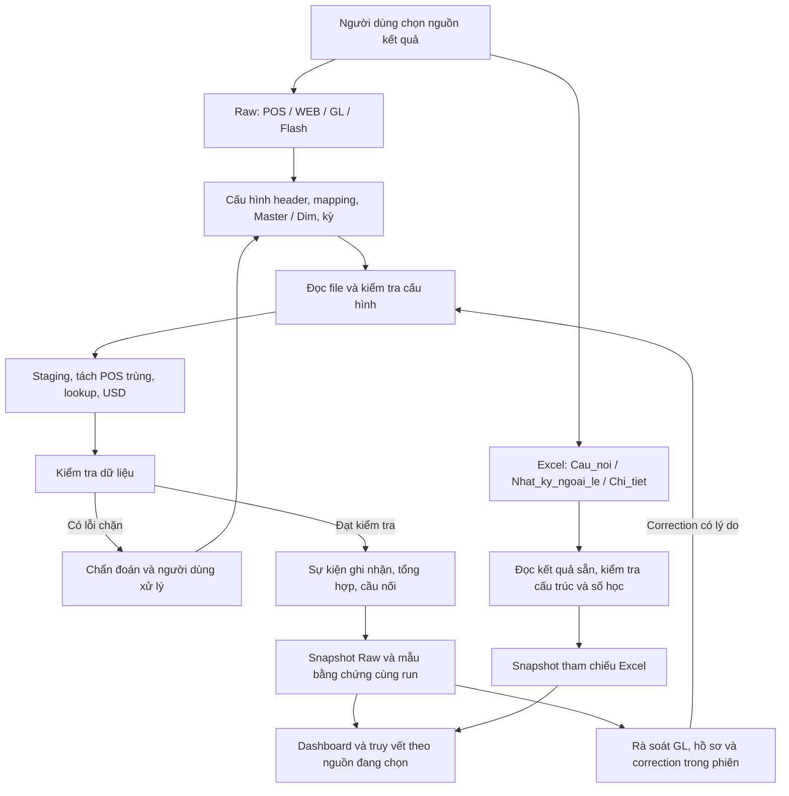

# Bản đồ ứng dụng khuyến nghị nghiên cứu vào chương trình reconcile.

- **Ngày rà soát:** 13/11/2026, theo múi giờ Europe/Berlin.
- **Mã nguồn đối chiếu:** commit `ed969a42233dfe191e6aac054a156c73ce8e55fc` — `Release 1`; phiên bản trong [package.json](../package.json) là `0.1.0`.
- **Thay đổi chưa commit:** working tree sạch khi bắt đầu. Tài liệu này và các Markdown liên quan là thay đổi chưa commit của lần rà soát; không sửa code ứng dụng, giao diện, cấu hình hay quy tắc nghiệp vụ.
- **Nguồn nghiên cứu:** [Memory.md](../Memory.md), “Báo cáo đối soát doanh thu”, bản Markdown chuyển từ PDF 50 trang, tác giả/nhóm được ghi ở đầu báo cáo. Phiên bản dùng là nội dung tại commit trên. Báo cáo nêu kỳ FY2025 và mốc trích xuất 15/01/2026; đây không phải ngày phát hành nghiên cứu. Chưa có số phiên bản/ngày phê duyệt bản cuối; PDF gốc không nằm trong cây file được Git theo dõi.
- **Nguồn khuyến nghị có nội dung:** mục X.3.1–X.3.5, trang PDF 42–45 theo chú thích của bản chuyển; đối chiếu thêm XI.3. Mục [XII/Bảng 41](../Memory.md#bang-41) vẫn có `[Điền]`; XIII và XIV cũng chưa hoàn chỉnh. Không coi bảng trống là kế hoạch đã được phê duyệt.
- **Phạm vi:** đọc source, SQL, cấu hình, toàn bộ Markdown được theo dõi, fixture và test; chạy bộ test hiện có và TypeScript. Không có đầy đủ workbook Raw POS/WEB/GL/Flash/Master bên ngoài repository để chạy lại toàn bộ ca nghiên cứu. Không kiểm tra giao diện bằng trình duyệt thật, hiệu năng thực tế, GitHub CI hoặc URL deploy.

## 1. Chương trình hiện đang làm gì?

`reconcile.` là ứng dụng trong trình duyệt giúp người làm phân tích doanh thu và Finance so sánh Sales Flash với doanh thu sổ cái. Người dùng chọn các file POS, WEB, Finance GL, Sales Flash và Master/Dim tùy chọn; xác nhận dòng tiêu đề, ánh xạ cột, quan hệ tham chiếu và kỳ đối soát. Ứng dụng dùng SheetJS và DuckDB-WASM để đọc file, chuẩn hóa, tách POS xuất lặp, tạo sự kiện ghi nhận, tổng hợp và tính cầu nối cùng phần chênh lệch còn lại.

Người dùng vẫn quyết định cách ánh xạ, tính đúng đắn của tỷ giá/ngày ghi nhận, ý nghĩa bút toán, chứng từ cần xem, phân loại hồ sơ và quyết định xử lý. Có nút lưu ghi chú, yêu cầu chứng từ, xem trước correction và hoàn tác trong phiên; ứng dụng không thay Finance phê duyệt nghiệp vụ, gửi email hay ghi ERP.

Đầu ra gồm dashboard bốn tab, cầu nối Flash → GL, so sánh cửa hàng/ngày và cửa hàng/tháng, nhật ký ngoại lệ, trang rà soát GL, báo cáo lỗi theo nguồn và các mẫu bảng cùng phiên tại **Xử lý dữ liệu** / **Quy tắc & mô hình dữ liệu**. Đây là công cụ minh họa đã có các đường xử lý được test bằng fixture, còn giới hạn về phạm vi quy tắc, lưu trữ và kiểm chứng trên dữ liệu thực.

Có hai nguồn kết quả độc lập: **Raw** tự tính từ file nguồn; **tham chiếu Excel** đọc kết quả đã có trong workbook. Cả hai dùng màn hình dashboard chung nhưng không có cùng mức bằng chứng về pipeline.

| Bước                    | Đầu vào                                 | Chương trình xử lý                                                                                                                           | Đầu ra                                             | Vai trò người dùng                                                                                      |
| ----------------------- | --------------------------------------- | -------------------------------------------------------------------------------------------------------------------------------------------- | -------------------------------------------------- | ------------------------------------------------------------------------------------------------------- |
| 1. Chọn file Raw        | CSV/XLSX của bốn nguồn; Dim tùy chọn    | Kiểm tra đuôi file, dung lượng, nguồn; đọc preview                                                                                           | File và bản nháp cấu hình                          | **Thủ công:** chọn file, nguồn; sửa gợi ý nếu sai                                                       |
| 2. Header và mapping    | Preview từng file                       | Gợi ý cột theo alias; xác nhận trường bắt buộc, cột trùng/không tồn tại                                                                      | `confirmedMappings`                                | **Thủ công:** chọn header và cột; fact XLSX chỉ đọc sheet đầu                                           |
| 3. Master/Dim           | Store, Calendar, FX Daily, FX Month End | Đọc sheet đã chọn; kiểm tra khóa đơn/ghép, unmatched và số dòng trước/sau join                                                               | Cấu hình và báo cáo joins                          | **Thủ công:** chọn vai trò, sheet, header, khóa, outputs và chính sách unmatched; **tự động:** kiểm tra |
| 4. Chuẩn hóa            | File và cấu hình đã xác nhận            | Đọc toàn file; chuyển XLSX/CSV header muộn qua worker, CSV header 1 đăng ký byte trực tiếp; projection, parse khóa/ngày/số tiền trong DuckDB | `raw_*`, staging và GL chuẩn hóa                   | **Tự động** sau khi bấm chạy; người dùng sửa dữ liệu/cấu hình khi lỗi                                   |
| 5. POS                  | Các bản export POS                      | Xếp hạng khóa receipt + line; giữ bản đầu, tách audit; lookup và quy đổi USD                                                                 | `q_POS_*`, `fact_POS_final`                        | **Tự động** theo quy tắc cố định; **rà soát** cảnh báo cùng khóa khác nội dung                          |
| 6. Kiểm tra nghiệp vụ   | POS/WEB/GL/Flash và tham chiếu          | Chặn dữ liệu không hợp lệ; giữ diagnostics và mẫu lỗi                                                                                        | Lỗi theo nguồn hoặc đầu vào hợp lệ                 | **Nghiệp vụ:** quyết định sửa nguồn/ánh xạ, chạy lại; không tự bỏ qua lỗi                               |
| 7. Ghi nhận và đối soát | POS keeper, WEB hợp lệ, GL, Flash tháng | Tạo sale/delivery/return events, tổng hợp store × date, full outer join, bridge và residual                                                  | `expected_events`, `daily_comparison`, kết quả Raw | **Tự động**; người dùng giải thích residual                                                             |
| 8. Tham chiếu Excel     | Workbook có ba sheet kết quả            | Đọc số sẵn, nhận diện loại điều chỉnh, giữ provenance, tính checks và chọn tháng                                                             | Kết quả Excel riêng                                | **Thủ công:** chọn workbook và bật hiển thị; không chạy thay Raw                                        |
| 9. Khai thác            | Snapshot Raw hoặc Excel đang chọn       | Lọc dashboard, mở rộng chart/bảng, tìm/xếp trang và xem nguồn                                                                                | Bốn tab và bảng chi tiết                           | **Rà soát:** đi từ tổng hợp tới bản ghi có sẵn trong phạm vi retained                                   |
| 10. Xử lý GL/ngoại lệ   | Hồ sơ và dữ liệu Raw hiện hành          | Lưu note/status/history; kiểm tra điều kiện confirmed; preview/apply/undo correction và tính lại                                             | Hồ sơ và dữ liệu hiệu lực trong phiên              | **Nghiệp vụ:** nhập mục đích, bằng chứng, quyết định, lý do correction; không ghi ERP                   |

Bằng chứng nối toàn luồng: [AppStoreProvider](../src/components/AppStoreProvider.tsx), `createAppStore` trong [store.ts](../src/lib/store.ts), `ReconciliationEngine.processUploads` / `execute` trong [engine](../src/lib/ReconciliationEngine.ts), [App.tsx](../src/App.tsx). Đường ứng dụng chọn `ingestionMode: 'wizard'`, `schemaMode: 'accounting'`; các mode `strict`/`compatible` còn trong code phục vụ legacy/test, không phải fallback tự động khi Raw lỗi.

## 2. Luồng xử lý dữ liệu Raw

### 2.1. Nhập và cấu hình

- Bốn nguồn bắt buộc: `POS`, `WEB`, `GL`, `Flash`. Có thể có nhiều file fact; chỉ một workbook Dim trong một batch. Giới hạn ở [uploads.ts](../src/lib/uploads.ts): 50 MiB/file, 20 file và 200 MiB/batch; chấp nhận `.csv`, `.xlsx`, không nhận `.xls`.
- Header do người dùng chọn, đánh số từ 1; preview và ingestion dùng cùng lựa chọn. Flash header dòng 5 là profile/ví dụ, không phải luôn tự bỏ bốn dòng. `workbookToCSV` trong [spreadsheet.ts](../src/lib/spreadsheet.ts) đọc **sheet đầu của file fact**; `workbookToSheets` hỗ trợ sheet được chọn cho Dim.
- `autoMapColumns`, `mappingIssues`, `confirmedMappingSnapshot` trong [data-mapping.ts](../src/lib/data-mapping.ts) gợi ý và kiểm tra mapping theo từng file. Gợi ý không phải xác nhận nghiệp vụ. POS/WEB net có thể không ánh xạ; khi đó dùng gross − discount trong phạm vi hợp đồng tiền tệ hỗ trợ. Net USD đã ánh xạ, kể cả 0, được ưu tiên; ô net đã map nhưng sai/rỗng không được âm thầm thay bằng phép tính khác.
- Master/Dim có bốn vai trò `store`, `calendar`, `fxDaily`, `fxMonthEnd`; mỗi vai trò chọn dùng hoặc không dùng. Cùng sheet dùng chung một header. Khóa ghép là các điều kiện AND, không phải join tự suy đoán. [master-data.ts](../src/lib/master-data.ts), `buildMasterJoins` trong [master-joins.ts](../src/lib/master-joins.ts) và [MasterDataConfigurator](../src/components/ingestion/MasterDataConfigurator.tsx) kiểm tra cấu hình và join trên dữ liệu đầy đủ. **Kiểm tra mapping/joins đạt chưa có nghĩa đã đối soát xong.**

### 2.2. Staging, POS trùng và USD

`raw_pos`, `raw_web`, `raw_gl`, `raw_flash` là projection đã áp dụng mapping/lookup, không phải bản sao byte nguyên trạng. POS giữ thêm `source_values`, các trường `raw_*` và thứ tự file/bản ghi để truy vết. Các checkpoint POS được định nghĩa ở [pos-pipeline-sql.ts](../src/lib/pos-pipeline-sql.ts):

`raw_pos → pos_staging → pos_ranked → q_POS_First_Export / q_POS_Cleaning → q_POS_Mapped → q_POS_USD → fact_POS_final → vw_pos`.

Nhánh audit đi qua `q_POS_Dup_Keys`, `q_POS_Dup_Rows`, `q_POS_Dup_Impact`. Khóa là **`receipt_no + line_no`**, chưa bao gồm cửa hàng. Xếp hạng theo `exported_at` sớm nhất, rồi `source_export_seq`, thứ tự file và dòng; timestamp có offset so theo thời điểm UTC. Khi thiếu `exported_at`, dùng sequence và thứ tự ổn định. Fact chỉ giữ `keep_rank = 1`; engine kiểm tra grain, số dòng và không đưa discarded exports vào fact. Cùng khóa khác nội dung được giữ dấu `content_variants` và cảnh báo, nhưng vẫn chọn bản sớm nhất: chưa có bước phê duyệt xung đột riêng.

POS local chia cho tỷ giá **local currency / 1 USD**. Gross/discount dùng daily FX; net dùng month-end khi có cấu hình, nếu không có cấu hình month-end thì dùng daily. Month-end đã cấu hình nhưng thiếu/sai không được thay bằng daily để che lỗi. USD có rate 1; supplied net USD không bị quy đổi/chiết khấu lần hai. Việc nhận diện cột local còn dựa vào tên cột như `line_amount`, `gross_local`, `discount_amount`; chỉ map một tên tùy ý không tự làm nó thành local. Cần kiểm tra hợp đồng trường trong `accountingProjection` ở [reconciliation-accounting.ts](../src/lib/reconciliation-accounting.ts).

**Quy đổi local FX hiện dành cho POS.** WEB, GL và Flash dùng các trường tiền USD; không có pipeline quy đổi local tổng quát cho cả bốn nguồn. FX thay đổi cơ sở có thể còn nằm trong `Unexplained` của cầu nối Raw, dù số USD từng dòng đã được tính đúng theo cấu hình.

### 2.3. Ngày, sự kiện ghi nhận và bảng tổng hợp

- POS có `business_date` và `posting_date`; nếu không có posting thì fallback business date. Calendar được cấu hình có thể cung cấp ngày hoặc posting date; cờ `working_day` không tự tạo thuật toán “ngày làm việc kế tiếp”. Phải có mapping ngày phù hợp và xem provenance thực tế.
- WEB giữ order/delivery/return date và trạng thái. Đơn hủy không tạo doanh thu kỳ giao; đơn giao tạo sự kiện dương tại ngày giao; đơn trả có cả sự kiện giao dương và trả âm tại ngày nhận trả. Các ngày/trạng thái mâu thuẫn bị chặn. Thiếu store WEB có quy ước ledger online `999999`, không suy ra cửa hàng vật lý.
- GL dùng ngày posting và `journal_id` duy nhất. Ledger basis đảo dấu một lần để ra doanh thu; revenue basis giữ dấu doanh thu qua cấu hình rõ ràng. GL chưa phân bổ vẫn nằm trong tổng công ty ở `UNALLOCATED`, không ép vào STORE/WEB. Correction là overlay lên dữ liệu hiệu lực trong phiên, giữ thông tin nguồn gốc.
- Flash giữ grain tháng (`month_end_date`), không join trực tiếp Flash vào từng đơn hàng. Kỳ Raw phải bắt đầu ngày đầu tháng và kết thúc ngày cuối tháng. Flash không có dòng trong kỳ hiện phát warning và hiển thị tổng 0; điều đó không chứng minh đã nhập đủ Flash.
- [DAILY_SQL](../src/lib/reconciliation-sql.ts) tạo `expected_events`, `expected_daily`, `gl_daily`, `daily_comparison`; so sánh sau khi mỗi bên tổng hợp **`store_key × posting_date`**. Không có khóa currency trong phép so sánh này vì tiền đã là USD. Chưa tự liên kết missing GL tháng trước với catchup tháng sau thành một hồ sơ xuyên kỳ.

“Bảng giao dịch chung” hiện là **lớp logic các relation chuẩn hóa và `expected_events`**, không có bảng vật lý lưu bền `unified_transactions`. Có `fact_POS_final`; không tìm thấy bộ fact vật lý `fact_WEB_final`/`fact_GL_final` tương đương toàn bộ mô hình Excel. WEB và GL dùng các view/table thực tế nêu trên và `gl_normalized`, `gl_clean`, `vw_gl_manual`, `vw_gl_system`, `vw_gl`.

### 2.4. Đối soát, lỗi chặn và đầu ra

`bridgeSQL` tính Flash, discounts, cancellations, timing, returns, data errors và GL. `Data_Errors` gồm POS duplicate adjustment và thiếu nhóm GL cửa hàng/ngày; GL có nhóm nhưng sai số tiền để lại variance/residual, không tự gọi là thiếu GL. Engine tính:

`Unexplained = GL_Finance − (Flash_Sales + Discounts + Cancellations + Timing_Differences + Returns + Data_Errors)`.

Raw chưa tách riêng đầy đủ FX, shipping, chuyển kênh và rounding như các dòng trong cầu nối Excel. Một residual khác 0 không tự chứng minh thất thoát, gian lận hoặc bút toán sai. Tiền dùng DECIMAL trong SQL, integer cents ở hợp đồng kết quả và BigInt cho các phép cộng kiểm soát; biểu đồ là biên hiển thị số.

Các kiểm tra khóa, ngày, tiền, trạng thái, duplicate GL/WEB và cardinality có thể chặn run. Khi lỗi, không phát snapshot thành công giả; giữ `RunFailure`/diagnostics và mẫu bản ghi theo nguồn khi xác định được. Cần người dùng sửa file/cấu hình rồi chạy lại. [run-failure.ts](../src/lib/run-failure.ts), [validation-failure.ts](../src/lib/validation-failure.ts), [pos-diagnostics.ts](../src/lib/pos-diagnostics.ts), [ReconciliationEngine.ts](../src/lib/ReconciliationEngine.ts) là bằng chứng.

Kết quả và exceptions được công bố cùng một run qua store; sửa nguồn/header/mapping/kỳ làm mất hiệu lực kết quả cũ. Guard generation/Abort loại callback muộn; SQL đang chạy hủy theo điểm chờ, không tức thời giữa một statement. Các relation tạm đóng khi run kết thúc; Dim được materialize và quản lý dọn khi đổi/xóa. Trang processing đọc snapshot giữ lại, không mở dịch vụ truy vấn toàn bộ DB sau run.

## 3. Chế độ tham chiếu Excel

Đây là adapter đọc **kết quả đã tính sẵn** từ [public/reference/excel-reference.xlsx](../public/reference/excel-reference.xlsx) hoặc workbook tương thích do người dùng chọn. [excel-reference.ts](../src/lib/excel-reference.ts) không chạy Power Query, DAX hay pipeline Raw, và không tính lại công thức workbook; nó dùng giá trị ô mà SheetJS đọc được, kể cả giá trị đã cache trong file.

| Sheet              | Nội dung đọc                                                      | Cách dùng                                                                                                                                                                                                                                  |
| ------------------ | ----------------------------------------------------------------- | ------------------------------------------------------------------------------------------------------------------------------------------------------------------------------------------------------------------------------------------ |
| `Cau_noi`          | Nhãn dòng cầu nối, 12 cột tháng cùng năm, `Cả năm`                | Nhận diện nhãn qua `classify`; ánh xạ mã `DISCOUNT`, `DUP_POS`, `CANCEL`, `RETURN`, `WEB_TIMING`, `POS_TIMING`, `INTERFACE`, `FX`, `SHIP`, `ROUND`, `UNEXPLAINED` và dòng tổng; tổng kỳ lấy từ các tháng, không cộng thêm `Cả năm`         |
| `Nhat_ky_ngoai_le` | ID, kỳ, phân loại, mô tả, owner, trạng thái và hướng xử lý đã ghi | Nhật ký tham chiếu và liên kết chi tiết; các ô này là nội dung nguồn, không phải người dùng vừa phê duyệt trong ứng dụng                                                                                                                   |
| `Chi_tiet`         | Mã điều chỉnh, kỳ, USD và các trường nguồn theo từng nhóm         | Bridge nối tới detail theo mã khoản và kỳ; bỏ các header lặp đã nhận diện, không quy đổi FX thêm. Inspector ngoại lệ mở dòng `Nhat_ky_ngoai_le` riêng; chưa có khóa ngoại tự động nối từng exception với từng transaction trong `Chi_tiet` |

Parser kiểm tra sheet/cột bắt buộc, kỳ tháng, numeric và ID ngoại lệ; các checks số học so thành phần bridge với Finance/tổng/check nguồn và các tháng với cả năm. Việc detail khớp bridge trên workbook đi kèm được kiểm chứng riêng trong [excel-reference.test.mjs](../tests/excel-reference.test.mjs), không thuộc 58 checks parser. **Check số học fail vẫn có thể được giữ để hiển thị**, không đồng nghĩa parser phải từ chối workbook. Trong 58 checks của workbook đi kèm có sáu control gắn với mẫu ban đầu (năm giá trị tiền và số lượng 10 ngoại lệ); workbook khác đúng cấu trúc vẫn có thể fail các control này. Không coi chúng là chuẩn chung cho mọi doanh nghiệp/kỳ.

`selectExcelReference` chọn các tháng thuộc khoảng kỳ, không phân bổ tỷ lệ theo ngày. `varianceUSD` của adapter là **Flash − Finance**; dashboard hiện hành dùng **Δ = GL − Flash**. Daily Raw variance cũng là GL − nguồn; delta trong Raw Exception Log là nguồn − GL. Cần đọc đúng ngữ cảnh dấu trước khi so sánh, xem [dashboard-model.ts](../src/lib/dashboard-model.ts), [reconciliation-sql.ts](../src/lib/reconciliation-sql.ts) và [EXCEL_REFERENCE_PREVIEW.md](../EXCEL_REFERENCE_PREVIEW.md).

[excel-reference-session.ts](../src/lib/excel-reference-session.ts) và store giữ Raw/reference riêng. Bật Excel không xác nhận mapping hoặc sửa lỗi Raw; tắt Excel trở lại trạng thái Raw đang có. Tài liệu phát hành ghi nhận workbook demo được cho phép công khai ngày 13/11/2026; đây là provenance từ [RELEASE_CHECK.md](../RELEASE_CHECK.md), không phải kết luận suy ra từ source code.

## 4. Năm mức kết luận cần tách riêng

| Mức                        | Điều có thể khẳng định                                                      | Điều chưa được chứng minh chỉ bằng mức này                                                         |
| -------------------------- | --------------------------------------------------------------------------- | -------------------------------------------------------------------------------------------------- |
| Khớp số học                | Các số cộng/trừ trong phạm vi kiểm tra khớp tolerance                       | Nguyên nhân và chứng từ đúng; ví dụ Excel bridge residual 0 vẫn chứa `UNEXPLAINED` 1.250 USD       |
| Hợp lệ cấu trúc            | Trường bắt buộc, kiểu dữ liệu, grain, khóa/join đạt các validator đã cài    | Đã có đủ mọi giao dịch thực tế, quy tắc kinh doanh đúng với tổ chức                                |
| Có giải thích nguyên nhân  | Quy tắc tính/mã loại hoặc nhận định hồ sơ chỉ ra cách hình thành chênh lệch | Nhãn/từ khóa/chú giải đã được Finance xác minh; Raw còn residual                                   |
| Có bằng chứng được rà soát | Người dùng ghi nguồn chứng từ và đánh dấu đã xem theo điều kiện hồ sơ       | Ứng dụng đã tải, xác thực chữ ký, quyền truy cập hay nội dung chứng từ; hiện không có chức năng đó |
| Hoàn tất quyết định xử lý  | Hồ sơ đáp ứng điều kiện `confirmed` và người dùng lưu quyết định            | Đã có phê duyệt độc lập, lưu bền, ghi ERP, hoặc hoàn tất toàn kỳ                                   |

`editReviewCase` ở [accounting-review.ts](../src/lib/accounting-review.ts) và tests [gl-review.test.mjs](../tests/gl-review.test.mjs) phân biệt đã xem (`reviewed`) với đã xác nhận (`confirmed`). Đổi classification/note không tự thay tiền; correction mới làm thay dữ liệu hiệu lực và chạy lại.

## 5. Bảng đối chiếu khuyến nghị

Các mã `NC-*` là mã biên tập để theo dõi các nội dung đã có trong **X.3** của báo cáo; không phải mã do tác giả nghiên cứu ban hành. `HT-*` là nhóm hỗ trợ rút từ ứng dụng/roadmap để tiếp tục đối chiếu, không phải kết luận chính thức của nghiên cứu.

**Khung đối chiếu tạm thời; cần cập nhật theo khuyến nghị nghiên cứu chính thức.** Câu này áp dụng cho cách phân nhóm/mã và các nhóm hỗ trợ, vì chưa có bản nghiên cứu cuối với kế hoạch XII đã hoàn tất; không phủ nhận nội dung khuyến nghị thực tế đã đọc ở X.3.

Trạng thái triển khai được hiểu như sau:

- **Đã áp dụng:** có triển khai và đường dùng xác định được trong phạm vi mục đã nêu; không hàm ý nghiệm thu toàn khuyến nghị gốc.
- **Áp dụng một phần:** có thành phần hoạt động nhưng thiếu một phần phạm vi.
- **Đang triển khai:** có bằng chứng công việc đang thực hiện. Lần rà soát này chưa có căn cứ gán trạng thái này cho một hạng mục.
- **Đã lên kế hoạch:** đã ghi trong roadmap nhưng chưa có triển khai; không tự suy ra chủ trì, ngân sách hoặc thời hạn được duyệt.
- **Chưa áp dụng:** chưa tìm thấy triển khai tương ứng trong phạm vi đã khảo sát.
- **Chưa xác minh:** chưa đủ bằng chứng để kết luận.

Trạng thái **kiểm chứng** được ghi riêng trong từng mục: code đã đọc, test nào đã chạy, hoặc còn cần chạy dữ liệu/UI thực. Có code không đồng nghĩa chạy đúng mọi trường hợp.

| Mã              | Khuyến nghị/nhóm cải thiện                          | Tính năng liên quan                                     | Trạng thái                                 | Bằng chứng chính                                                                                                      | Phần còn thiếu                                                                   |
| --------------- | --------------------------------------------------- | ------------------------------------------------------- | ------------------------------------------ | --------------------------------------------------------------------------------------------------------------------- | -------------------------------------------------------------------------------- |
| [NC-01](#nc-01) | Thống nhất cơ sở ghi nhận — X.3.1                   | Ngày POS/WEB/GL, net, FX, events                        | **Áp dụng một phần**                       | [accountingProjection](../src/lib/reconciliation-accounting.ts), [DAILY_SQL](../src/lib/reconciliation-sql.ts)        | FX đa nguồn, tự suy lịch làm việc, đối chiếu đủ dữ liệu thực                     |
| [NC-02](#nc-02) | Tách POS xuất lặp khỏi doanh thu — phần X.3.2       | Keeper, duplicate audit và impact                       | **Đã áp dụng** trong phạm vi tách kỹ thuật | [ACCOUNTING_POS_CLASSIFICATION_SQL / ACCOUNTING_POS_FACT_SQL](../src/lib/pos-pipeline-sql.ts)                         | Phê duyệt bản cùng khóa khác nội dung; kiểm chứng khóa có duy nhất liên cửa hàng |
| [NC-03](#nc-03) | Đối chiếu POS–GL trước khóa sổ — X.3.3              | Store/day comparison, Missing GL, store/month threshold | **Áp dụng một phần**                       | [DAILY_SQL / exceptionSQL](../src/lib/reconciliation-sql.ts), [storeMonthBreaches](../src/lib/dashboard-model.ts)     | Grain currency, tự nối catchup xuyên kỳ và kiểm soát khóa sổ                     |
| [NC-04](#nc-04) | Rà soát bút toán tay/chứng từ — X.3.4               | GL review, transfer pair, UNALLOCATED, correction       | **Áp dụng một phần**                       | [gl-review.ts](../src/lib/gl-review.ts), [accounting-review.ts](../src/lib/accounting-review.ts)                      | Xác thực chứng từ, người duyệt độc lập, lưu bền                                  |
| [NC-05](#nc-05) | Chốt bridge và tách loại nguyên nhân — X.3.1, X.3.5 | Bridge, explicit residual, Excel adapter                | **Áp dụng một phần**                       | [bridgeSQL](../src/lib/reconciliation-sql.ts), [engine](../src/lib/ReconciliationEngine.ts)                           | Raw chưa có đủ dòng nguyên nhân như Excel; không có phê duyệt toàn kỳ            |
| [NC-06](#nc-06) | Tự động QC, kỳ kỳ vọng và dấu — X.3.5               | Validators, diagnostics, period, arithmetic checks      | **Áp dụng một phần**                       | [POS_ROW_ISSUES](../src/lib/pos-pipeline-sql.ts), [VALIDATION_SQL](../src/lib/reconciliation-sql.ts)                  | Chưa đủ nguyên bộ bảy checks; ngày hoạt động cửa hàng, completeness kỳ           |
| [NC-07](#nc-07) | Nhật ký có owner/hạn/bằng chứng/trạng thái — X.3.5  | Review cases, exception actions, history                | **Áp dụng một phần**                       | [store.ts](../src/lib/store.ts), [accounting-review.ts](../src/lib/accounting-review.ts)                              | Không mọi exception đều có hồ sơ GL; chưa theo dõi bền xuyên kỳ/đa người         |
| [NC-08](#nc-08) | Đo hiệu quả qua các kỳ — đoạn cuối X.3.5            | Cần baseline vận hành                                   | **Chưa áp dụng**                           | [Nguồn yêu cầu: Memory X.3](../Memory.md#muc-x)                                                                       | Chưa có thiết kế đo trước–sau, dữ liệu thời gian/độ chính xác qua kỳ             |
| [HT-01](#ht-01) | Chuẩn hóa nhập và mapping — nhóm hỗ trợ             | Wizard, header, per-file mapping                        | **Đã áp dụng**                             | [data-mapping.ts](../src/lib/data-mapping.ts), [OnboardingWizard](../src/components/ingestion/OnboardingWizard.tsx)   | Fact sheet picker; profile tái dùng                                              |
| [HT-02](#ht-02) | Quản lý Master/Dim và FX — nhóm hỗ trợ              | Roles, composite joins, rate validation                 | **Áp dụng một phần**                       | [master-data.ts](../src/lib/master-data.ts), [master-joins.ts](../src/lib/master-joins.ts)                            | Quản trị phiên bản/phê duyệt reference; FX ngoài POS                             |
| [HT-03](#ht-03) | Minh bạch xử lý và truy vết mẫu — nhóm hỗ trợ       | Progress, RunEvidence, processing/methodology           | **Đã áp dụng** trong phạm vi snapshot mẫu  | [captureRunEvidence](../src/lib/reconciliation-evidence.ts), [DataProcessing](../src/pages/DataProcessing.tsx)        | Chưa là kho audit toàn bộ dòng, lưu bền hoặc query sau run                       |
| [HT-04](#ht-04) | Trực quan hóa để rà soát — nhóm hỗ trợ              | Bốn tab, filter, expansion, inspector                   | **Đã áp dụng**                             | [DashboardSuite](../src/components/dashboard/DashboardSuite.tsx), [dashboard-model.ts](../src/lib/dashboard-model.ts) | Country filter; bridge/Flash theo kênh thiếu dữ liệu; browser QA                 |
| [HT-05](#ht-05) | Rules Engine cấu hình công thức — roadmap           | Trang quy tắc hiện chỉ đọc                              | **Đã lên kế hoạch**                        | [ARCHITECTURE §13](../ARCHITECTURE.md#13-roadmap-configurable-rules-engine)                                           | Chưa có editor, expression compiler và rule version của người dùng               |
| [HT-06](#ht-06) | Lưu profile mapping/rule để tái dùng — roadmap      | Hiện chỉ state trong tab                                | **Đã lên kế hoạch** ở mức hướng đi         | [ARCHITECTURE §13](../ARCHITECTURE.md#13-roadmap-configurable-rules-engine), [store.ts](../src/lib/store.ts)          | Chưa save/restore, backend hay hồ sơ xuyên phiên                                 |

## 6. Giải thích từng mục và bằng chứng

### NC-01 — Thống nhất cơ sở ghi nhận

- **Vấn đề/nguồn:** X.3.1 của [báo cáo](../Memory.md#muc-x) yêu cầu lưu riêng trạng thái/ngày, phân biệt gross với net và ngày bán/đặt với giao/trả/ghi sổ.
- **Hiện thực/phạm vi:** Raw tự tính theo `accountingProjection`, các `ACCOUNTING_POS_*` trong [POS SQL](../src/lib/pos-pipeline-sql.ts) và `expected_events` trong [DAILY_SQL](../src/lib/reconciliation-sql.ts). Người dùng chọn mapping/ngày/FX, xác nhận nghiệp vụ. Excel chỉ trình bày các điều chỉnh đã có.
- **Kiểm chứng:** `npm.cmd test` đã chạy và đạt các ca `accounting recognition excludes cancellations, books returns on return_date, and handles cross-month timing` trong [reconciliation.test.mjs](../tests/reconciliation.test.mjs) và nhóm [pos-calendar-fx.test.mjs](../tests/pos-calendar-fx.test.mjs). Đây là fixture, không phải tái chạy toàn ca FY2025 thực.
- **Giới hạn/tiếp theo:** WEB/GL/Flash cần USD; chưa tự suy ngày làm việc tiếp theo; POS dựa hợp đồng tên cột local. Dashboard Raw tính tỷ lệ trả/giao từ USD net đầu vào (`net_usd_month_end`), chưa xác minh nó theo FX ngày đặt như nghiên cứu X.3.1; chưa chứng minh tái lập tỷ lệ 2,21% của báo cáo. Cần xác nhận bộ quy tắc phiên bản cuối và chạy boundary đầu/cuối năm với nguồn thực.

### NC-02 — Tách POS xuất lặp

- **Vấn đề/nguồn:** X.3.2 yêu cầu doanh thu lấy từ bảng đã lọc trùng, lưu số dòng/giá trị loại bỏ; cùng khóa khác nội dung phải được vận hành xác minh. Phần tách kỹ thuật đã được triển khai, toàn bộ quy trình phê duyệt của X.3.2 vẫn chưa đủ.
- **Hiện thực/phạm vi:** Raw tự xếp hạng, giữ keeper trong `fact_POS_final`, giữ discarded rows/impact ở nhánh audit. Người dùng xem diagnostics và cảnh báo; không có thao tác duyệt từng xung đột POS riêng. [pos-pipeline-sql.ts](../src/lib/pos-pipeline-sql.ts), [PosDiagnosticsView](../src/components/processing/PosDiagnosticsView.tsx), kiểm tra grain/cardinality trong [engine](../src/lib/ReconciliationEngine.ts).
- **Kiểm chứng:** [pos-pipeline.test.mjs](../tests/pos-pipeline.test.mjs) đã chạy, gồm `local POS converts each USD basis once and keeps duplicate impact outside fact` và `duplicate audit retains extra source fields and warns for changed products with equal amounts`. Ví dụ số đã chạy ở §7.1.
- **Giới hạn/tiếp theo:** Khóa receipt + line giả định duy nhất giữa các file/cửa hàng. Cùng khóa khác nội dung chỉ warning, vẫn lấy earliest. Đề xuất rà soát khóa nghiệp vụ và thêm quyết định xung đột; chưa coi đề xuất này là roadmap được phê duyệt.

### NC-03 — Đối chiếu POS với GL trước khóa sổ

- **Vấn đề/nguồn:** X.3.3 yêu cầu so store × ngày hạch toán × tiền tệ, đối chiếu hai chiều và liên kết catchup với ngoại lệ gốc.
- **Hiện thực/phạm vi:** Raw tự full outer join tổng expected với GL theo store/date sau quy đổi USD; phân biệt không có GL group với group có nhưng sai tiền. Dashboard tổng hợp store/month dùng đồng thời **|Δ| > 200 USD và > 1% |GL|**, tách mẫu số GL = 0. `storeMonthBreaches` ở [dashboard-model.ts](../src/lib/dashboard-model.ts). Exception Log có filter khác: **|delta| > 200 USD** mặc định, không áp thêm 1%.
- **Kiểm chứng:** Các ca `accounting distinguishes genuine absent store-days from present but mismatched GL totals` trong [reconciliation.test.mjs](../tests/reconciliation.test.mjs) và `safe ratios and strict store-month thresholds separate zero denominators and boundary equality` trong [dashboard-model.test.mjs](../tests/dashboard-model.test.mjs) đã chạy đạt. Excel detail dùng kết quả đối soát đã có, không tái dựng join Raw.
- **Giới hạn/tiếp theo:** Grain so sánh không giữ currency; chưa có matching tự động catchup khác tháng hay cơ chế chặn khóa sổ. Cần Finance xác nhận thủ công mối liên hệ và kiểm tra nguồn thực theo cả kỳ gốc/kỳ bù.

### NC-04 — Bút toán tay, chứng từ và correction

- **Vấn đề/nguồn:** X.3.4 yêu cầu tách shipping/chuyển kênh/chưa xác minh, giữ UNALLOCATED, lưu chứng từ/mục đích/kỳ/người duyệt và kiểm tra cặp chuyển kênh tổng bằng 0.
- **Hiện thực/phạm vi:** Raw có `GLRecord`, gợi ý `suggestGLClassification` theo nội dung/từ khóa, `transferIssue` kiểm tra cặp journal và `editReviewCase` kiểm tra quyết định. [gl-review.ts](../src/lib/gl-review.ts), [accounting-review.ts](../src/lib/accounting-review.ts), [AccountingReview](../src/pages/AccountingReview.tsx). Người dùng nhập evidence dạng text/link và đánh dấu `evidenceReviewed`. `confirmed` cần nguồn còn hiệu lực, phân loại có giải thích, mục đích, evidence đã rà soát và quyết định; cặp chuyển kênh còn phải hợp lệ.
- **Kiểm chứng:** [gl-review.test.mjs](../tests/gl-review.test.mjs), [gl-preview.test.mjs](../tests/gl-preview.test.mjs), [accounting-review-ui.test.mjs](../tests/accounting-review-ui.test.mjs) đã chạy đạt: giữ GL chưa phân bổ, dấu doanh thu một lần, yêu cầu evidence/decision, correction preview/apply/undo và invalidation. Excel case ADJ chỉ là hồ sơ đã ghi trong workbook.
- **Giới hạn/tiếp theo:** Không upload/xác thực chứng từ, không có tài khoản để kiểm chứng người duyệt. Correction cần lý do, chỉ sửa overlay và chạy lại trong phiên; không sửa file gốc/ERP. Đổi nhãn không tự làm residual hết. Cần quy trình phê duyệt và lưu chứng từ bền trước sử dụng vận hành nhiều người; xem [GL_ACCOUNTING_REVIEW.md](../GL_ACCOUNTING_REVIEW.md).

### NC-05 — Cầu nối và phần chưa giải thích

- **Vấn đề/nguồn:** X.3.1 và X.3.5 yêu cầu tách nguyên nhân và kiểm tra tổng cầu nối, không che phần chưa giải thích.
- **Hiện thực/phạm vi:** Raw tính các nhóm cố định bằng `bridgeSQL`; engine giữ residual rõ ràng. `buildWaterfall` trong [reconciliation-types.ts](../src/lib/reconciliation-types.ts) chèn Unexplained khi khác 0. Excel giữ các dòng nguyên nhân nguồn, có đủ chi tiết FX/SHIP/ROUND/UNEXPLAINED được đọc từ workbook. Người dùng chịu trách nhiệm xác nhận giải thích và chốt kỳ.
- **Kiểm chứng:** Ca `accounting distinguishes genuine absent store-days from present but mismatched GL totals` trong [reconciliation.test.mjs](../tests/reconciliation.test.mjs) giữ residual −10 USD riêng; [pos-pipeline.test.mjs](../tests/pos-pipeline.test.mjs) giữ residual −9,59 trong fixture khác cơ sở FX. Fixture 12 shipping + chuyển kênh + ADJ trong [gl-review.test.mjs](../tests/gl-review.test.mjs) để lại Raw residual **96.016,95 USD**, gồm shipping 94.766,95 và ADJ 1.250; phân loại hồ sơ không tự tách shipping ra bridge. [excel-reference.test.mjs](../tests/excel-reference.test.mjs) kiểm tra không tạo balancing adjustment khi số học lệch. Các ca này đã chạy đạt.
- **Giới hạn/tiếp theo:** Raw chưa tự phân rã đủ như Excel; missing GL là phân loại kỹ thuật theo sự vắng mặt nhóm, chưa là kết luận nguyên nhân cuối. Cần đặc tả cách tách FX/shipping/rounding/chuyển kênh và tránh đếm trùng. Chưa có bước phê duyệt toàn bộ bridge để phát hành.

### NC-06 — Kiểm tra chất lượng, kỳ và quy ước dấu

- **Vấn đề/nguồn:** X.3.5 yêu cầu chạy bảy phép kiểm tra trên toàn kỳ trước filter, khai báo khoảng ngày kỳ vọng, dùng GL − Flash và tolerance cầu nối trong 1 USD.
- **Hiện thực/phạm vi:** Raw kiểm tra toàn dữ liệu đăng ký trước xuất snapshot qua [POS_STAGING_ISSUES / POS_ROW_ISSUES](../src/lib/pos-pipeline-sql.ts), [VALIDATION_SQL](../src/lib/reconciliation-sql.ts) và các kiểm tra GL trong [gl-pipeline.ts](../src/lib/gl-pipeline.ts). Dashboard filter đọc snapshot, không chạy lại pipeline. Raw có `validatePeriod`; Excel kiểm tra số học với tolerance 0,01 USD, không phải ngưỡng 1 USD của báo cáo. Dashboard dùng GL − Flash; adapter Excel/exception giữ quy ước dấu riêng ở §3.
- **Kiểm chứng:** [run-failure.test.mjs](../tests/run-failure.test.mjs), [pos-calendar-fx.test.mjs](../tests/pos-calendar-fx.test.mjs), [reconciliation.test.mjs](../tests/reconciliation.test.mjs) và [excel-reference.test.mjs](../tests/excel-reference.test.mjs) đã chạy đạt với dữ liệu thiếu/sai/kỳ và lệch control.
- **Giới hạn/tiếp theo:** Không tái hiện nguyên bộ bảy QC của báo cáo; chưa có ngày mở/đóng cửa trong `ReferenceField`, nên chưa kiểm tra POS sau đóng cửa. Kỳ hợp lệ và ngày parse được chưa chứng minh đủ coverage POS; Flash không có dòng kỳ chỉ warning. Chưa có tự lọc Total/subtotal Flash. Cần checklist QC hoàn chỉnh và expected coverage do Finance cung cấp.

### NC-07 — Nhật ký ngoại lệ và theo dõi quyết định

- **Vấn đề/nguồn:** X.3.5 yêu cầu kỳ gốc, giá trị, bằng chứng, owner, hạn, trạng thái; Finance duyệt khoản mở trước phát hành và theo dõi kỳ sau.
- **Hiện thực/phạm vi:** Raw exceptions có ID, ngày, cửa hàng, tham chiếu và delta; store lưu review cases với original periods, owner/dueDate/nextStep/history, tạo yêu cầu chứng từ và đồng bộ case GL với ngoại lệ. [exceptions.ts](../src/lib/exceptions.ts), [store.ts](../src/lib/store.ts), [accounting-review.ts](../src/lib/accounting-review.ts). Người dùng quyết định và nhập thông tin. Excel đọc owner/status/resolution từ workbook, không biến chúng thành quyết định Raw.
- **Kiểm chứng:** [gl-review.test.mjs](../tests/gl-review.test.mjs), [accounting-review-ui.test.mjs](../tests/accounting-review-ui.test.mjs), [exceptions.test.mjs](../tests/exceptions.test.mjs), [excel-reference-session.test.mjs](../tests/excel-reference-session.test.mjs) đã chạy đạt. Nguồn/config thay đổi mở lại case, bỏ hiệu lực evidence/correction cũ và giữ history trong phiên; bấm lại yêu cầu đang chờ không tạo yêu cầu trùng.
- **Giới hạn/tiếp theo:** Không mọi POS/Missing GL exception đều có hồ sơ quản trị đủ như case GL; không có cơ sở dữ liệu, nhắc hạn hoặc liên kết hồ sơ bền giữa kỳ/phiên. Mailto chỉ mở bản nháp, CSV ERP chỉ là draft cần review. Cần định nghĩa lifecycle chung cho mọi loại ngoại lệ và lưu bền; chưa là công việc đã được phê duyệt.

### NC-08 — Đo hiệu quả cải thiện qua kỳ

- **Vấn đề/nguồn:** Đoạn cuối X.3.5 yêu cầu baseline kỳ đầu, thời gian tới duyệt, ngoại lệ còn mở và giá trị chưa giải thích.
- **Hiện trạng/phạm vi:** Chưa tìm thấy thiết kế đánh giá trước–sau hoặc tập dữ liệu vận hành qua kỳ. Progress và case history cung cấp mốc trong phiên nhưng không phải nghiên cứu hiệu quả có baseline. Đây là **Chưa áp dụng** cho việc đo có hệ thống; hiệu quả thực tế là **Chưa xác minh**.
- **Kiểm chứng:** Đã đối chiếu code; chưa kiểm chứng bằng chạy thử một nghiên cứu hiệu quả. Bộ test chỉ kiểm tra hành vi ứng dụng; không thể dùng 227 test đạt làm số đo giảm thời gian/sai sót.
- **Tiếp theo:** Lập phương án thu thập tại §8, xác định người duyệt và cùng một bộ nguồn cho cách thủ công/công cụ. Không tự tạo tỷ lệ cải thiện.

### HT-01 — Chuẩn hóa đầu vào và mapping

- **Vấn đề/nguồn:** Nhóm hỗ trợ rút từ ứng dụng, liên quan cấu trúc nguồn ở [Memory V–VII](../Memory.md#muc-v); không phải mục riêng đã phê duyệt tại XII.
- **Hiện thực/phạm vi:** Raw có `OnboardingWizard`, `HeaderRowSelector`, `DataMappingView`, `autoMapColumns`, kiểm tra trước confirmation. Máy gợi ý; người dùng chọn header/cột/nguồn. Excel có parser theo schema cố định, không dùng wizard mapping Raw.
- **Kiểm chứng:** [data-mapping.test.mjs](../tests/data-mapping.test.mjs), [header-row.test.mjs](../tests/header-row.test.mjs), [header-row-ui.test.mjs](../tests/header-row-ui.test.mjs), [onboarding.test.mjs](../tests/onboarding.test.mjs) đã chạy đạt; bao gồm header muộn, cột sai/trùng, stale preview và confirm.
- **Giới hạn/tiếp theo:** Fact XLSX chỉ sheet đầu; chưa lưu profile dùng lại; chưa QA picker/drag/drop thật. Bổ sung sheet picker là đề xuất phát triển, không mô tả là đã có.

### HT-02 — Master/Dim và FX

- **Vấn đề/nguồn:** Nhóm hỗ trợ về tham chiếu; liên quan [Memory V, VII](../Memory.md#muc-vii) và NC-01/03.
- **Hiện thực/phạm vi:** Raw cho cấu hình sheet/header/field/relationship theo bốn vai trò; `masterFingerprint` ràng buộc validation với cấu hình. `buildMasterJoins` đo duplicate/unmatched/rows-before-after, kiểm soát fanout. FX POS kiểm tra rate và provenance. Người dùng chọn các quan hệ, nguồn và cơ sở tiền. Excel chỉ giữ tỷ giá/tiền đã tính để truy vết.
- **Kiểm chứng:** [master-data.test.mjs](../tests/master-data.test.mjs), [pos-pipeline.test.mjs](../tests/pos-pipeline.test.mjs), [pos-calendar-fx.test.mjs](../tests/pos-calendar-fx.test.mjs) đã chạy đạt với khóa ghép, unmatched, duplicate rates, calendar fallback và currency.
- **Giới hạn/tiếp theo:** Chưa có quản trị version tham chiếu đã phê duyệt hoặc lưu dùng lại; không suy rate từ thuộc tính journal GL; local FX ngoài POS chưa có. Cần nguồn Master/FX chính thức và hợp đồng tỷ giá trước chạy dữ liệu thực.

### HT-03 — Minh bạch xử lý và truy vết

- **Vấn đề/nguồn:** Nhóm hỗ trợ để tái kiểm tra quá trình, không phải kết luận hiệu quả đã đo.
- **Hiện thực/phạm vi:** Raw có progress theo bước SQL thực, diagnostics khi lỗi và `captureRunEvidence` trước đóng connection; giữ runId/config/schema/full counts và **tối đa 50 dòng/bảng**. Processing và Methodology là chế độ xem đọc; `RecordProof` chỉ nối input/logic/output đã giữ. Excel giữ tên workbook/sheet/dòng nguồn và `referenceDetailsFor`; inspector dashboard giới hạn tối đa 199 detail/bridge.
- **Kiểm chứng:** [evidence.test.mjs](../tests/evidence.test.mjs), [source-coordinates.test.mjs](../tests/source-coordinates.test.mjs), [processing-progress.test.mjs](../tests/processing-progress.test.mjs), [processing-ui.test.mjs](../tests/processing-ui.test.mjs), [workspace-ui.test.mjs](../tests/workspace-ui.test.mjs) đã chạy đạt về same-run, invalidation, tọa độ và phạm vi mẫu.
- **Giới hạn/tiếp theo:** Bộ lọc processing chỉ tìm trong retained rows; source record ordinal không phải lúc nào cũng là physical source row. Metadata rule hiển thị không đồng nghĩa đã áp dụng trong run. Không có kho lineage tất cả dòng hoặc audit bất biến; cần thiết kế riêng nếu dùng cho kiểm toán vận hành.

### HT-04 — Dashboard hỗ trợ rà soát

- **Vấn đề/nguồn:** Nhóm hỗ trợ cho drill-down nghiên cứu X/XI, giúp xem đồng thời số tiền và tỷ lệ.
- **Hiện thực/phạm vi:** [DashboardSuite](../src/components/dashboard/DashboardSuite.tsx) và `buildDashboardModel` dùng nguồn đang chọn cho bốn tab: tổng quan, cầu nối, đối soát chi tiết, chất lượng/ngoại lệ. Có bộ lọc tháng, điều kiện kênh, tìm/xếp trang, mở rộng chart/bảng, inspector/link hồ sơ. Thao tác xem không chạy lại Raw; người dùng chọn phạm vi và suy xét nguyên nhân.
- **Kiểm chứng:** [dashboard-model.test.mjs](../tests/dashboard-model.test.mjs), [dashboard-detail.test.mjs](../tests/dashboard-detail.test.mjs), [dashboard-expansion.test.mjs](../tests/dashboard-expansion.test.mjs) đã chạy đạt, gồm số 0 khác thiếu dữ liệu, filter cùng phạm vi, mở rộng giữ state và focus mô phỏng.
- **Giới hạn/tiếp theo:** Country filter chưa hỗ trợ. Chọn kênh không tạo Flash/bridge theo kênh khi nguồn thiếu grain đó; Raw vẫn có phần GL/detail phù hợp. Với Excel, KPI tổng/cầu nối thiếu phân bổ được để trống, một số chỉ tiêu quality theo `Kenh` vẫn lọc được; không phải toàn bộ nguồn bị unavailable. Excel không có đủ mẫu số delivered nên không tự suy return rate; một số detail store/day không có. Raw return rate dùng USD net đầu vào, chưa xác nhận đúng cơ sở FX ngày đặt của nghiên cứu. Tổng Raw lấy full `DashboardSnapshot`, không cộng 50 dòng evidence/200 dòng daily preview. Chưa QA hình vẽ/overflow/bàn phím thật; xem [DASHBOARD_REVIEW.md](../DASHBOARD_REVIEW.md).

### HT-05 — Rules Engine cấu hình công thức

- **Vấn đề/nguồn:** Roadmap ghi tại [ARCHITECTURE §13](../ARCHITECTURE.md#13-roadmap-configurable-rules-engine), không phải hạng mục có owner/deadline trong XII.
- **Hiện trạng/phạm vi:** Chưa có editor công thức. Gross − discount, recognition và bridge là SQL cố định. Methodology/RuleBrowser chỉ đọc metadata và evidence; không cấu hình hay chạy expression người dùng.
- **Kiểm chứng:** Đã đối chiếu code; chưa kiểm chứng bằng chạy thử Rules Engine vì chưa có triển khai. [workspace-ui.test.mjs](../tests/workspace-ui.test.mjs) đã chạy để kiểm tra trang quy tắc hiện tại chỉ đọc.
- **Giới hạn/tiếp theo:** Roadmap đề cập typed expressions, compiler SQL, DECIMAL và version rule theo run. Chưa thấy bằng chứng đang xây dựng hoặc thời hạn cam kết; giữ **Đã lên kế hoạch**.

### HT-06 — Profile tái dùng và dữ liệu qua phiên

- **Vấn đề/nguồn:** Hướng phát triển “persisted mapping/rule profiles” trong [ARCHITECTURE §13](../ARCHITECTURE.md#13-roadmap-configurable-rules-engine). Lưu cả hồ sơ tài chính bền là đề xuất cần đặc tả thêm, không tự gộp thành kế hoạch được duyệt.
- **Hiện trạng/phạm vi:** `createAppStore` giữ state trong RAM, DuckDB mở `:memory:`; [Settings](../src/pages/Settings.tsx) nêu refresh xóa phiên. Chọn/tắt Excel giữ Raw riêng trong cùng tab, không phải save/restore phiên. Cả hai nguồn đều chưa có lưu hồ sơ qua refresh.
- **Kiểm chứng:** Đã đối chiếu code; chưa kiểm chứng bằng chạy thử cơ chế lưu bền vì chưa có triển khai. [store.test.mjs](../tests/store.test.mjs), [excel-reference-session.test.mjs](../tests/excel-reference-session.test.mjs) đã chạy đạt về coordination/session, không phải persistence.
- **Giới hạn/tiếp theo:** Chưa có database/backend, tài khoản, sync thiết bị, profile lưu lại hay hồ sơ xuyên phiên. Cần quyết định phạm vi lưu/export/import, bảo toàn version nguồn/rule và lifecycle review trước triển khai.

## 7. Ví dụ có căn cứ

Các kết quả sau đã được kiểm chứng qua test có sẵn trong lần rà soát. Dữ liệu Raw là **fixture tổng hợp**, không phải bằng chứng đã nhập lại đầy đủ workbook nghiên cứu thực tế.

### 7.1. POS trùng và khác cơ sở FX

- **Đầu vào:** hai dòng cùng receipt `R`, line `1`, store `S`, ngày 01/03/2025; export lúc 08:00 ngày 01/03 và 02/03. Gross 65,37 AUD, discount 7,85 AUD; daily rate 1,5 và month-end 2 local/USD.
- **Xử lý:** giữ export sớm nhất; net local 57,52; daily gross 43,58 USD, daily discount 5,23, daily net 38,35; finance net month-end 28,76. Duplicate đi nhánh audit, không vào fact.
- **Kết quả đã chạy:** [pos-pipeline.test.mjs](../tests/pos-pipeline.test.mjs), ca `local POS converts each USD basis once and keeps duplicate impact outside fact`, xác nhận fact một dòng và duplicate bridge adjustment **−38,35 USD**. Ca full-engine cùng file xác nhận `GL_Finance = 28,76`, `Unexplained = −9,59`, duplicate exception delta **+38,35** theo dấu nguồn − GL.
- **Giới hạn:** residual −9,59 phản ánh hai cơ sở FX chưa được tách thành dòng FX Raw. Đây không phải kết luận sai rate. Cùng khóa khác product vẫn chỉ warning; cần người dùng rà soát.

### 7.2. Chênh lệch do ghi nhận khác kỳ

- **Đầu vào Raw:** ca `accounting recognition excludes cancellations, books returns on return_date, and handles cross-month timing` trong [reconciliation.test.mjs](../tests/reconciliation.test.mjs) dùng accounting mode, kỳ tháng 03/2025. WEB có đơn `IN` đặt 28/02, giao 01/03, net 360 USD; `OUT` đặt 31/03, giao 01/04, net 270 USD; `R` giao 28/02, trả 01/03, net 180 USD; `C` hủy với net 90 USD. Flash tháng 03 là 400 USD.
- **Xử lý:** nhận doanh thu `IN` trong tháng 03, chuyển `OUT` sang tháng 04, ghi trả của `R` trong tháng 03, loại doanh thu giao của đơn hủy.
- **Kết quả đã chạy:** discounts −40 USD, cancellations −90, timing **+90** (=360−270), returns **−180**, GL **180**, data errors **0**, Unexplained **0**. Không dùng kết quả mode compatible để kết luận validators accounting đã đạt.
- **Ví dụ Excel riêng:** [excel-reference.test.mjs](../tests/excel-reference.test.mjs) đọc `POS_TIMING` tháng 05 khoảng **−41.464,78 USD**, tháng 06 **+41.464,78 USD**, ngoại lệ `EX-03` kỳ `05-06/2025`. Số hiển thị được làm tròn cent, parser giữ độ chính xác ô gốc. Đây là kết quả Excel đã có, không tái dựng Calendar từ Raw trong ví dụ đó.

### 7.3. Bút toán tay cần chứng từ

- **Đầu vào:** fixture [gl-review.test.mjs](../tests/gl-review.test.mjs) có journal `JE20250904892`, posting 30/09/2025, MANUAL, ledger amount −1.250 USD, source ref `MJ-ADJ-2509`, description `ADJ-0925`, chưa có store và kênh `UNALLOCATED`; kèm system revenue 110 USD.
- **Xử lý:** đảo dấu ledger một lần; giữ revenue +1.250 ở company GL, đưa vào hồ sơ cần rà soát, không ép phân bổ. Nhập mã tham chiếu không thay việc kiểm tra chứng từ.
- **Kết quả đã chạy:** ca `valid unallocated manual adjustment stays in company GL and remains unexplained`: GL **1.360 USD**, Unexplained **1.250 USD**, store kỹ thuật `-1`, channel `UNALLOCATED`; tests điều kiện review ngăn confirmed nếu thiếu evidence/decision.
- **Giới hạn:** fixture tái tạo tình huống từ nghiên cứu; chưa có chứng từ gốc được kiểm tra trong lần này. Excel tháng 09 cũng có `EX-05`, owner Finance, trạng thái “Cần chứng từ”; trạng thái này là dữ liệu workbook.

### 7.4. Khoản chưa giải thích không bị đổi thành lỗi dữ liệu

- **Đầu vào:** fixture accounting trong [reconciliation.test.mjs](../tests/reconciliation.test.mjs) có POS NX057 ngày 21/11/2025 là 7.228 USD chưa có GL group; NX007 cùng ngày có POS 500 USD và GL revenue 490 USD; NX057 ngày 22/11 có nguồn/GL đều 100 USD. Flash là 7.828 USD.
- **Xử lý:** chỉ store-day NX057 ngày 21/11 là missing GL; NX007 đã có group GL nên lệch tiền giữ ở residual.
- **Kết quả đã chạy:** ca `accounting distinguishes genuine absent store-days from present but mismatched GL totals`: một missing GL group, missing adjustment và `Data_Errors` đều **−7.228 USD**, `Unexplained = −10 USD`.
- **Giới hạn:** số −10 chưa xác định nguyên nhân nghiệp vụ; cần truy nguồn/chứng từ. Số 7.228 là fixture làm tròn, không thay số nghiên cứu NX057 7.227,56 USD.

### 7.5. Excel hiển thị được nhưng chưa chứng minh Raw hoàn tất

- **Đầu vào:** workbook đi kèm, ba sheet tại §3.
- **Xử lý:** parser đọc 15 dòng cầu nối, 10 ngoại lệ, 39.062 dòng chi tiết, bỏ 11 header lặp; tạo 58 checks. Tổng năm dùng 12 tháng; không cộng thêm cột cả năm và không đổi FX lần nữa.
- **Kết quả đã chạy:** [excel-reference.test.mjs](../tests/excel-reference.test.mjs), [dashboard-model.test.mjs](../tests/dashboard-model.test.mjs) xác nhận Flash **31.124.401 USD**, GL **28.698.496,23 USD**, dashboard Δ **−2.425.904,77 USD**. Adapter `varianceUSD` cùng phạm vi là **+2.425.904,77 USD** do quy ước Flash − GL. 58 checks đạt trên workbook này; bridge residual **0** vẫn chứa khoản Unexplained **1.250 USD**.
- **Giới hạn:** đây là xác minh đọc và đối chiếu số học workbook, không xác minh lại mọi nguyên nhân hay chứng từ; không phải run Raw FY2025. Cột `fact_POS_final` của mô hình Excel được mô tả trong báo cáo không đồng nghĩa fact Raw hiện tại còn giữ duplicate.

## 8. Có thể sử dụng chương trình này làm minh họa nghiên cứu như thế nào?

| Nội dung minh họa                         | Cách trình bày và bằng chứng                                                                                                                                                             | Giới hạn kết luận                                                                   |
| ----------------------------------------- | ---------------------------------------------------------------------------------------------------------------------------------------------------------------------------------------- | ----------------------------------------------------------------------------------- |
| Kiểm soát đầu vào                         | Chọn header/mapping; cố tình dùng cột sai; xem validation và sửa cấu hình — [data-mapping/header tests](../tests/data-mapping.test.mjs)                                                  | Minh họa kiểm soát đã cài; chưa chứng minh giảm lỗi vận hành                        |
| Minh bạch xử lý                           | Xem progress thực, POS keeper/duplicate/USD/fact cùng run — [processing/evidence](../tests/evidence.test.mjs)                                                                            | Mẫu 50 dòng/bảng, không phải toàn bộ audit archive                                  |
| Tách lỗi dữ liệu khỏi khác biệt nghiệp vụ | So POS duplicate với delivery/return timing; để residual rõ — [POS](../tests/pos-pipeline.test.mjs), [reconciliation](../tests/reconciliation.test.mjs)                                  | Phân loại Raw chưa đủ nguyên nhân như Excel; cần Finance xác minh                   |
| Tổ chức hàng chờ rà soát                  | Mở case GL, yêu cầu chứng từ, nhập purpose/decision, áp correction có lý do — [GL UI](../tests/accounting-review-ui.test.mjs)                                                            | Quy trình trong phiên, chưa có phê duyệt độc lập hoặc lưu bền                       |
| Liên kết tổng hợp với nguồn               | Chọn bridge/exception rồi xem workbook row hoặc retained Raw record — [dashboard detail](../tests/dashboard-detail.test.mjs), [source coordinates](../tests/source-coordinates.test.mjs) | Chỉ truy được trong phạm vi dữ liệu đã giữ; cần ghi rõ ordinal với physical row     |
| Dùng kết quả nghiên cứu để thảo luận      | Bật Excel xem kỳ, nguyên nhân và ngoại lệ từ ca nghiên cứu                                                                                                                               | Không dùng việc dashboard hiển thị thành công làm bằng chứng Raw đã tự tính toàn bộ |

**Chức năng đã triển khai khác với hiệu quả đã đo.** Chưa có dữ liệu đánh giá cho kết luận giảm thời gian, giảm sai sót hoặc tăng độ tin cậy. Các lợi ích đó là kỳ vọng cần kiểm chứng; không có tỷ lệ cải thiện trước–sau được xác lập trong lần rà soát này.

Chỉ tiêu đề xuất cho nghiên cứu tiếp theo:

| Chỉ tiêu                          | Dữ liệu cần thu thập                                                                       | Cách so sánh cần thiết                                                     |
| --------------------------------- | ------------------------------------------------------------------------------------------ | -------------------------------------------------------------------------- |
| Thời gian từ chốt nguồn tới duyệt | Mốc dữ liệu sẵn sàng, bắt đầu/kết thúc chạy, thời gian xử lý ngoại lệ và duyệt             | Cùng phạm vi nguồn/kỳ; tách thời gian máy, thao tác và chờ chứng từ        |
| Ngoại lệ phát hiện và bỏ sót      | Danh sách chuẩn do Finance xác nhận, true/false positive/negative, số tiền liên quan       | So cách thủ công với công cụ; không dùng số cảnh báo làm số lỗi đúng       |
| Ngoại lệ còn mở và residual       | ID ổn định, kỳ gốc/kỳ xử lý, status, giá trị tuyệt đối chưa giải thích                     | Theo dõi nhiều kỳ, tránh netting che các khoản ngược dấu                   |
| Số thao tác thủ công              | Lần map/sửa file/correction/request evidence, vai trò thực hiện                            | Cùng kịch bản; history trong RAM cần cơ chế lưu nghiên cứu riêng           |
| Khả năng truy vết                 | Mẫu tổng hợp chọn trước, tìm được source record/chứng từ/decision hay không, thời gian tìm | Ghi cả bản ghi ngoài retained preview và sau refresh                       |
| Hiệu năng/độ ổn định              | Cấu hình máy, browser, số dòng/dung lượng, runtime, lỗi và peak memory nếu đo được         | Cùng môi trường; test fixture không đại diện thiết bị yếu hoặc file tối đa |

## 9. Kế hoạch đã ghi nhận và đề xuất mới

**Đã ghi trong repository trước rà soát:** Rules Engine và profile mapping/rule tái dùng ở [ARCHITECTURE §13](../ARCHITECTURE.md#13-roadmap-configurable-rules-engine); fact sheet picker, code splitting/parser reference sang worker và browser/deploy QA ở [RELEASE_CHECK.md](../RELEASE_CHECK.md). Đây là hướng phát triển/checklist có văn bản, chưa có bằng chứng owner, ngân sách, deadline hay công việc đang triển khai. Không gọi chúng là kế hoạch được Finance phê duyệt. Header riêng từng sheet Dim đã triển khai, đã loại khỏi danh sách việc tương lai lỗi thời.

**Kế hoạch nghiên cứu được phê duyệt:** chưa xác định được từ tài liệu hiện có; Bảng 41 còn trống. Cần tác giả cung cấp bản cuối để xác nhận thứ tự, người phụ trách, thời hạn và chỉ số.

**Đề xuất mới từ lần rà soát, chưa được xác nhận:** phê duyệt xung đột POS; xác nhận tính duy nhất khóa receipt/line; hoàn thiện QC/ngày hoạt động cửa hàng/completeness kỳ; tách đủ FX/shipping/rounding/chuyển kênh Raw; nối catchup và hồ sơ xuyên kỳ; quản lý bằng chứng/người duyệt/lưu bền cho mọi ngoại lệ; thu baseline hiệu quả. Các thiếu sót này chỉ được tài liệu hóa, chưa sửa code.

## 10. Cập nhật khi nghiên cứu hoàn tất

1. Đọc bản nghiên cứu cuối; lưu tên file, tác giả, số phiên bản, ngày phê duyệt và vị trí trang/mục của từng khuyến nghị. Bổ sung PDF/tài liệu gốc hoặc đường dẫn truy cập được.
2. Gán mã khuyến nghị chính thức. **Giữ nguyên `NC-*`/`HT-*` và anchor hiện có**; thêm bảng ánh xạ mã chính thức ↔ mã ứng dụng, không đổi mã theo số thứ tự trang mới.
3. Ghép từng khuyến nghị với mục hiện có, giữ nguyên phạm vi Raw/Excel, mức tự động và vai trò người dùng. Có thể ghép nhiều–nhiều; một dashboard chung không có nghĩa hai nguồn xử lý giống nhau.
4. Thêm khuyến nghị chưa được ứng dụng giải quyết; dùng `Chưa áp dụng` hoặc `Chưa xác minh` theo bằng chứng. Không coi Bảng 41 trống là đã có kế hoạch.
5. Đọc lại code/test theo commit mới; chạy đúng kịch bản cần thiết, ghi lệnh, dữ liệu, kết quả và giới hạn. Tách trạng thái triển khai khỏi kiểm chứng, số học khỏi evidence/decision.
6. Ghi ngày, commit/version, thay đổi chưa commit và nội dung thay đổi; cập nhật README/tài liệu chuyên đề nếu kết luận thay đổi. Giữ roadmap đã xác nhận riêng với đề xuất của người rà soát.

Thông tin cần người nghiên cứu bổ sung: bản cuối mục XII–XIV, Bộ quy tắc ghi nhận C.1–C.3 được báo cáo nhắc tới, danh mục nguồn/phiên bản và bộ Raw+Master/FX tương ứng, chứng từ các khoản còn mở, thẩm quyền/quy trình phê duyệt và baseline hiệu quả. Chưa dùng tài liệu quy tắc được nhắc tên nhưng không có nội dung trong repo như một nguồn đã kiểm chứng độc lập.

## 11. Kiểm tra đã thực hiện và phần chưa biết

| Kiểm tra ngày 13/11/2026                                           | Kết quả/phạm vi                                                                                                                                                                                                                                                                                     |
| ------------------------------------------------------------------ | --------------------------------------------------------------------------------------------------------------------------------------------------------------------------------------------------------------------------------------------------------------------------------------------------- |
| `git status --short`, `git log -1` trước chỉnh sửa                 | Working tree sạch; xác định commit và package version ở đầu file                                                                                                                                                                                                                                    |
| `npm.cmd test`                                                     | **227/227 đạt**, 0 fail, 0 skipped, khoảng 49 giây, Node 24.13.1/npm 11.8.0 trên Windows; DuckDB-WASM thực trong Node và React DOM qua jsdom. Suite gồm cả accounting và legacy strict/compatible; các ví dụ Raw ở §7 dùng accounting. Log Worker lỗi trong startup test là tình huống cố ý giả lập |
| `npm.cmd run typecheck`                                            | Đạt, exit 0                                                                                                                                                                                                                                                                                         |
| Liên kết Markdown, anchor và định dạng                             | Script cục bộ kiểm tra **261 liên kết nội bộ/anchor trên 10 Markdown**, không có đích thiếu. Prettier `--check` đạt cho cả chín file bàn giao; `git diff --check` không có lỗi whitespace; diff chỉ thay đổi Markdown                                                                               |
| Build/lint/HTTP preview                                            | Không chạy lại trong lần tài liệu hóa; xem hồ sơ lịch sử có giới hạn ở [RELEASE_CHECK.md](../RELEASE_CHECK.md)                                                                                                                                                                                      |
| Browser thật, Vercel/GitHub CI, toàn bộ Raw thực tế và đo hiệu quả | **Chưa xác minh** trong lần này                                                                                                                                                                                                                                                                     |

Tài liệu chuyên đề giữ các kết quả lịch sử nhưng đã phân biệt mốc đó với hiện trạng: [kiến trúc](../ARCHITECTURE.md), [POS audit](../POS_PIPELINE_AUDIT.md), [GL review](../GL_ACCOUNTING_REVIEW.md), [Excel reference](../EXCEL_REFERENCE_PREVIEW.md), [dashboard review](../DASHBOARD_REVIEW.md), [dashboard UX](../DASHBOARD_UX.md), [release](../RELEASE_CHECK.md). [Memory.md](../Memory.md) giữ nguyên nội dung chuyển từ nghiên cứu; không hiệu đính kết quả nghiên cứu chỉ vì ứng dụng hiện đã khác mô hình Excel.

## 12. Tóm tắt bàn giao cho AI/lập trình viên tiếp theo

- Chỉ tài liệu hóa ở đợt này, không sửa ứng dụng. Căn cứ source tại commit ghi đầu file; các bản Markdown mới chưa commit.
- Đã có đường Raw thật qua mapping/joins → POS staging/dedup/FX → validators → recognition/aggregation → bridge/exceptions → snapshot. Fixture chạy đạt; chưa chạy lại đầy đủ nguồn nghiên cứu thực.
- Excel là đường đọc kết quả tính sẵn, không chạy Raw. Cầu nối Excel có nhiều loại nguyên nhân hơn Raw; số học khớp không chứng minh chứng từ/decision đã hoàn tất.
- POS Raw fact đã bỏ discarded exports; fact Excel được mô tả trong nghiên cứu là sản phẩm khác. Khóa dedup receipt + line, khác nội dung hiện chỉ warning. Local FX mới cho POS; Calendar cần cấu hình rõ.
- GL chưa phân bổ giữ trong tổng; evidence/decision do người dùng nhập. Correction chỉ overlay trong phiên, có lý do/preview/recompute/undo. Không có backend, tài khoản, ERP posting hoặc lưu sau refresh.
- Dashboard có full aggregates cùng run; các mẫu truy vết bị giới hạn. Không dùng mẫu evidence để suy tổng. Chưa xác minh layout/browser/deploy.
- Nguồn khuyến nghị có X.3.1–X.3.5, nhưng XII còn trống. Giữ mã/anchor bản đồ để bổ sung nguồn và khuyến nghị cuối; không tự gán roadmap thành đã triển khai hay hiệu quả đã đo.

## 13. Lịch sử cập nhật

| Ngày       | Phiên bản đối chiếu                                       | Nội dung                                                                                                                                                                                      |
| ---------- | --------------------------------------------------------- | --------------------------------------------------------------------------------------------------------------------------------------------------------------------------------------------- |
| 13/11/2026 | `ed969a4`, package `0.1.0`; thay đổi Markdown chưa commit | Lập bản đồ từ source/SQL/tests và Memory X.3; phân biệt Raw/Excel, trạng thái triển khai/kiểm chứng, ví dụ fixture/workbook, giới hạn và hướng cập nhật; sửa tài liệu liên quan cho nhất quán |
